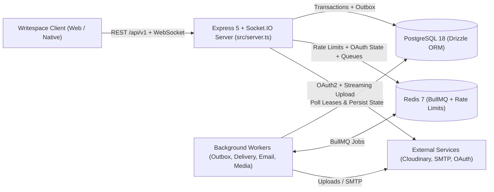

# Writespace Engineering Documentation

> **Purpose:** Orient developers, first-party client integrators, and operators to the Writespace backend codebase, architecture, and operational workflows.
> **Audience:** 1) Internal backend developers, 2) First-party web/native client developers, 3) Operations maintainers.
> **Prerequisites:** None. Start with [5-Minute Quickstart](getting-started/quickstart.md) to boot the stack locally.

## Overview

Writespace (`writespace-backend` `v1.0.0`) is a social blogging backend designed for developers, technical students, and software engineering communities. It combines short-form social updates (**Posts**) and long-form technical publishing (**Articles**) on top of a unified relational identity (`content_items`). Because both content types share a common primary key in `content_items`, social interactions — threaded comments, seven reaction types, bookmarks (`content_saves`), shares, and user `@mentions` — operate through one consistent persistence and event pipeline.

The backend is implemented in TypeScript on Node.js 24 using Express 5, Socket.IO, Drizzle ORM over PostgreSQL, and BullMQ over Redis. Domain state changes and asynchronous notification triggers are coordinated through a PostgreSQL transactional outbox (`outbox_events`), ensuring that in-app notifications, real-time WebSocket events, and transactional emails never drift out of sync with committed database state.

## System at a glance

**Diagram: High-Level System Overview**

## How to navigate this documentation

Choose a path based on your role and immediate task:

| Section                    | Primary Audience    | What You Will Find                                                                                                  | Start Here                                                        |
| :------------------------- | :------------------ | :------------------------------------------------------------------------------------------------------------------ | :---------------------------------------------------------------- |
| **Getting Started**        | New Internal Devs   | Tooling prerequisites, Docker vs. native Node.js setup, seeding, and a guided code tour.                            | [5-Minute Quickstart](getting-started/quickstart.md)              |
| **Core Concepts**          | All Engineers       | Mental model of the shared `content_items` identity, `ContentDocument` JSONB blocks, and domain glossary.           | [System Mental Model](concepts/overview.md)                       |
| **Architecture**           | Internal Devs       | C4 context/container/component diagrams, request & outbox data flows, and technology choices.                       | [Architecture Overview](architecture/overview.md)                 |
| **Codebase Guide**         | Internal Devs       | Annotated folder tree, module boundaries, `src/server.ts` lifecycle, and layering conventions.                      | [Repository Structure](codebase/repository-structure.md)          |
| **Application Modules**    | Internal Devs       | Deep-dives into auth, sessions, users, posts, articles, interactions, notification, and media handling.             | [Posts & Articles](modules/content.md)                            |
| **Data & Storage**         | Internal Devs & Ops | All 28 PostgreSQL tables, Drizzle migrations (`DATABASE_DIRECT_URL`), deterministic UUID v5 seeding, and PII rules. | [Database Schema Reference](data/schema.md)                       |
| **First-Party API**        | Client Integrators  | First-party REST contracts (`/api/v1/*`), cookie/bearer token flows, error envelopes, and Socket.IO events.         | [API Overview](api/overview.md)                                   |
| **Backend Infrastructure** | Internal Devs       | Row-locking rules, BullMQ queues, outbox dispatcher, delivery reconciliation, and Redis key namespaces.             | [Background Jobs & Queues](backend/background-jobs-and-queues.md) |
| **Security**               | Internal Devs & Ops | Threat model, SHA-256/HMAC/bcrypt credential hashing, CSRF origin enforcement, and rate limiters.                   | [Threat Model](security/threat-model.md)                          |
| **Operations (Path A)**    | Operations          | Single-VM Oracle Cloud Ampere A1 deployment plan, memory budgets, backups, and incident runbooks.                   | [Environments](operations/environments.md)                        |
| **Architecture Decisions** | All Engineers       | 10 evidence-backed ADRs explaining why key database, auth, outbox, and deployment choices were made.                | [ADR Index](decisions/README.md)                                  |
| **Reference**              | All Engineers       | Complete environment variable table, CLI scripts, config files, dependencies, and v1 roadmap.                       | [Environment Variables](reference/env-vars.md)                    |

## Core architectural pillars

- **Shared Content Identity (`content_items`):** Every Post (`posts.id`) and Article (`articles.id`) uses a 1:1 foreign-key primary key referencing `content_items.id` (see `src/db/schema/content-items.ts`, `src/db/schema/posts.ts`, and `src/db/schema/articles.ts`). Comments, reactions, saves, shares, and mentions reference `content_items.id` directly.

- **Server-Managed Sessions & Refresh Token Rotation:** Access tokens are short-lived HS256 JWTs (`JWT_ACCESS_EXPIRE`, default `15m`) bound to a database session ID (`sid`) verified on every request via `sessionService.isSessionValidForAccess` (`src/shared/middlewares/auth.middleware.ts`). Opaque refresh tokens are hashed with SHA-256 (`refresh_tokens.token_hash`), rotated on every use, and trigger full session revocation if token reuse is detected (`src/modules/sessions/refresh-token.repository.ts`).

- **Transactional Outbox & Dual-Lease Delivery:** Domain mutations write events into `outbox_events` inside the same PostgreSQL transaction (`src/modules/notification/services/event-publisher.service.ts`). Background workers claim outbox rows and channel deliveries (`notification_deliveries`) using expiring database leases, while a reconciliation worker repairs lost or stalled BullMQ jobs (`src/modules/notification/services/notification-reconciliation.service.ts`).

## Key decisions & rationale

- **First-party API boundary:** The `/api/v1` REST surface and Socket.IO server are engineered exclusively for the Writespace web and native client (`CLIENT_URL`) rather than public third-party developers, allowing tight coupling between frontend state needs and backend cursor/session contracts (see [API Overview & First-Party Scope](api/overview.md)).

- **Single-process modular monolith:** The HTTP server, Socket.IO server, and BullMQ workers initialize inside `src/server.ts`, simplifying local development and single-VM deployment (Path A) while preserving strict module boundaries under `src/modules/`.

## Gotchas & edge cases

- **Outbox pipeline is opt-in via environment configuration:** `OUTBOX_PROCESSING_ENABLED` defaults to `"false"` in `src/config/env.ts` until database migrations are applied. When `"false"`, domain services skip recording notification events and `src/server.ts` does not start the outbox dispatcher or notification workers.

- **Startup validation requires all mandatory secrets:** `src/config/env.ts` validates all required variables at boot — including `JWT_ACCESS_SECRET`, `JWT_REFRESH_SECRET`, `AUTH_CHALLENGE_SECRET` (64 hex chars), Cloudinary credentials, SMTP credentials, `AI_MODEL`, and `GEMINI_API_KEY` — and exits immediately with code `1` if any are missing.

## Related

- [Prerequisites](getting-started/prerequisites.md)
- [5-Minute Quickstart](getting-started/quickstart.md)
- [System Mental Model](concepts/overview.md)
- [Architecture Overview (C4 L1 & L2)](architecture/overview.md)

---

_Last verified against: v1.0.0 (12bc4d7, documentation branch, 2026-11-17)_
