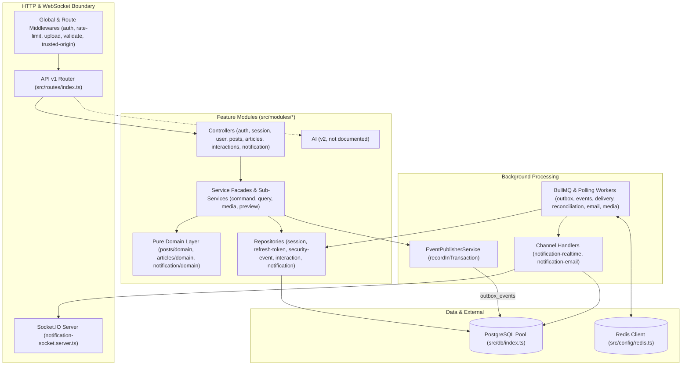

# Component Breakdown (C4 L3)

> **Purpose:** Detail the internal component layering inside `src/` and show how HTTP routes, controllers, services, pure domain utilities, repositories, and background workers interact.
> **Audience:** Internal backend developers working in `src/modules/` and `src/shared/`.
> **Prerequisites:** Read [Architecture Overview (C4 L1 & L2)](overview.md).

## Overview

Inside `src/`, Writespace enforces a strict layered component architecture across its feature modules (`auth`, `sessions`, `users`, `posts`, `articles`, `interactions`, `notification`). Incoming HTTP requests traverse global security and parsing middlewares (`src/app.ts`), route-specific rate limiters and Zod validators (`src/shared/middlewares/`), thin HTTP controllers, application services (which coordinate transactions and outbox publishing), pure domain modules (`*/domain/`), and Drizzle ORM repositories (`*/repositories/`).

## C4 Level 3 — Internal component diagram

**Diagram: C4 Level 3 Internal Component Architecture**

## Layer-by-layer component responsibilities

### 1. HTTP & WebSocket boundary (`src/app.ts`, `src/routes/index.ts`, `src/shared/middlewares/`)

| Component                 | File Path                                              | Responsibility                                                                                                                                                                                                                                                                                                                                                                            |
| :------------------------ | :----------------------------------------------------- | :---------------------------------------------------------------------------------------------------------------------------------------------------------------------------------------------------------------------------------------------------------------------------------------------------------------------------------------------------------------------------------------- |
| Global App Pipeline       | `src/app.ts`                                           | Registers `helmet()`, `cors()`, `cookieParser()`, `express.json()`, `express.urlencoded()`, `httpLogger`, `/uploads` static serving, `passport.initialize()`, `botInterceptor`, `/api/v1` (`apiLimiter` + routes), `/health`, and `errorHandler`.                                                                                                                                         |
| API v1 Router             | `src/routes/index.ts`                                  | Mounts `/auth`, `/users`, `/sessions`, `/posts`, `/articles`, `/ai` (v2, not documented), `/notifications`, `/notification-preferences`, and `/interactions`.                                                                                                                                                                                                                             |
| Auth & RBAC Middleware    | `src/shared/middlewares/auth.middleware.ts`            | `authenticate` verifies the Bearer JWT (HS256), validates UUID claims (`id`, `sid`) and `role` (`user` \| `admin`), and checks `sessionService.isSessionValidForAccess(sid, id)`. `authorize(...allowedRoles)` enforces role-based access.                                                                                                                                                |
| Trusted Origin CSRF Guard | `src/shared/middlewares/trusted-origin.middleware.ts`  | `requireTrustedOriginForCookieAuth` inspects requests carrying a `refreshToken` cookie and verifies that the `Origin` (or fallback `Referer`) header matches `new URL(env.CLIENT_URL).origin`.                                                                                                                                                                                            |
| Redis Rate Limiters       | `src/shared/middlewares/rate-limit.middleware.ts`      | Provides 10 `express-rate-limit` instances backed by `rate-limit-redis` (`rl:<prefix>:`): IP-based limiters (`apiLimiter`, `loginLimiter`, `registerLimiter`, `emailVerificationLimiter`, `forgotPasswordLimiter`, `resetPasswordLimiter`) and SHA-256 email-based limiters (`loginEmailLimiter`, `registerEmailLimiter`, `emailVerificationEmailLimiter`, `forgotPasswordEmailLimiter`). |
| Cloudinary Upload Engine  | `src/shared/middlewares/upload.middleware.ts`          | Custom Multer `CloudinaryStorageEngine` streaming `.jpg`, `.jpeg`, `.png`, `.gif`, and `.webp` files (up to `MAX_FILE_SIZE_MB` and `MAX_FILES_PER_UPLOAD`) to `uploads/users/<userId>/` in Cloudinary.                                                                                                                                                                                    |
| Multipart JSON Parser     | `src/shared/middlewares/parse-form-data.middleware.ts` | `parseFormDataJson` parses JSON-encoded multipart text fields (`tags`, `codeSnippets`, `existingMedia`, `existingMediaPublicIds`) before Zod validation.                                                                                                                                                                                                                                  |
| Zod Request Validator     | `src/shared/middlewares/validate.middleware.ts`        | `validate(schema)` parses `{ body, query, params }` against a Zod object schema and replaces `req.body` with `parsed.body`.                                                                                                                                                                                                                                                               |
| Crawler Bot Interceptor   | `src/shared/middlewares/bot-interceptor.middleware.ts` | Intercepts crawler `User-Agent` requests on `/post/:id` and `/profile/:username` (excluding `/profile/me`) and returns escaped Open Graph HTML.                                                                                                                                                                                                                                           |

### 2. Controllers (`src/modules/*/*.controller.ts`)

Controllers translate HTTP requests into typed service calls and wrap outputs in `new ApiResponse(res, statusCode, message, data).send()` (`src/shared/utils/api-response.ts`):

- **`AuthController`** (`src/modules/auth/auth.controller.ts`): Manages `refreshToken` cookie setting/clearing for web clients vs. JSON body delivery for native clients, and handles Google/GitHub OAuth callbacks.
- **`SessionController`** (`src/modules/sessions/session.controller.ts`): Sets `Cache-Control: private, no-store` and clears the browser `refreshToken` cookie when the current session or all sessions are revoked.
- **`UserController`** (`src/modules/users/user.controller.ts`): Handles username availability checks, user search, profile reads/updates, password changes, soft-delete suspension, follow toggling, and raw `image/png` streaming from `generateProfileOgImage` (`GET /api/v1/users/og/:username`).
- **`PostsController`** (`src/modules/posts/posts.controller.ts`) & **`ArticlesController`** (`src/modules/articles/articles.controller.ts`): Normalize `application/json` and `multipart/form-data` bodies (`contentDocument`, `tags`, `removeMediaIds` / `removeCoverImage`), map uploaded `req.files` via media services, and delegate to `postService` / `articleService`.
- **`InteractionsController`** (`src/modules/interactions/interactions.controllers.ts`): Single plural-named controller file exporting all comment, reaction, follow, save, and share handlers.
- **`NotificationController`** & **`NotificationPreferenceController`** (`src/modules/notification/`): Enforce `Cache-Control: private, no-store` on all inbox and preference responses.

### 3. Service facades, sub-services & pure domain layer

Writespace uses two internal service patterns depending on module complexity:

**Facade + Sub-Services + Pure Domain (posts and articles):**

- **Public Facade** (`posts.service.ts`, `articles.service.ts`): Consumed by controllers; composes `command`, `query`, and `preview` sub-services and delegates like and share operations to `interactionsService`.
- **Sub-Services** (`services/*-{command,query,media,preview}.service.ts`): Separate write transactions (`postCommandService`, `articleCommandService`), cursor-paginated feed queries (`postQueryService`, `articleQueryService`), media diffing (`postMediaService`, `articleMediaService`), and public crawler metadata (`postPreviewService`, `articlePreviewService`).
- **Pure Domain** (`domain/*-{content,lifecycle,slug}.ts`): Stateless, database-free functions enforcing status transition matrices (`VALID_TRANSITIONS`), character/word counting, reading-time calculation (200 WPM), mention UUID extraction, and slug generation.

**Service + Repository (sessions, interactions, notification):**

- Services (`session.service.ts`, `comment.service.ts`, `reaction.service.ts`, `follow.service.ts`, `save.service.ts`, `share.service.ts`, `notification-processor.service.ts`, `notification-delivery.service.ts`, `outbox-dispatcher.service.ts`, `notification-reconciliation.service.ts`) own business orchestration, cursor encoding/decoding, and transaction boundaries, while delegating SQL queries and `FOR UPDATE` row locks to dedicated `*Repository` classes.


**AI Module Scope (v2):** The route mount `/api/v1/ai` in `src/routes/index.ts` and the files under `src/modules/ai/` and `src/shared/ai/` belong to the experimental v2 AI post-assistant and are intentionally excluded from v1 component documentation (see [AI Integration (Gemini) — Coming in v2](../modules/ai.md)).


## Key decisions & rationale

- **Why keep `*/domain/` free of database imports?** Isolating `post-content.ts`, `post-lifecycle.ts`, `article-content.ts`, `article-lifecycle.ts`, `notification-policy.registry.ts`, and `notification-grouping.policy.ts` from Drizzle/PostgreSQL allows domain invariants (such as allowed status transitions, 5-minute UTC grouping buckets, and character counts) to be reasoned about and unit-tested deterministically without database state.
- **Why do `posts` and `articles` query services access `db` directly instead of using separate repository files?** In `posts` and `articles`, read projections (`post-query.service.ts`, `article-query.service.ts`, `post-preview.service.ts`, `article-preview.service.ts`) and write commands (`post-command.service.ts`, `article-command.service.ts`) are already split into dedicated CQRS-style sub-services, avoiding an extra pass-through repository layer.

## Gotchas & edge cases

- **Double JSON parsing in multipart routes:** Both `parseFormDataJson` middleware (`src/shared/middlewares/parse-form-data.middleware.ts`) and controller helpers (`parseJsonFields` in `posts.controller.ts` and `articles.controller.ts`) parse multipart JSON strings. `parseFormDataJson` parses `tags`, `codeSnippets`, `existingMedia`, and `existingMediaPublicIds` before `validate(Schema)` runs, while `parseJsonFields` in the controllers also parses `contentDocument`, `tags`, `removeMediaIds`, and `removeCoverImage`. If a client sends invalid JSON in `contentDocument` during a `multipart/form-data` request, `validate(CreatePostSchema)` will fail before the controller runs because `contentDocument` is not in `parseFormDataJson`'s `jsonFields` array (`["tags", "codeSnippets", "existingMedia", "existingMediaPublicIds"]`).
- **Profile authorization runs before Multer upload:** On `PUT /api/v1/users/:id` (`src/modules/users/user.routes.ts`), `authorizeProfileOwnerOrAdmin` is registered before `upload.fields(...)` so an unauthorized user cannot stream files to Cloudinary before being rejected with `403 Forbidden`.

## Related

- [Architecture Overview (C4 L1 & L2)](overview.md)
- [Request & Event Data Flow](data-flow.md)
- [Module Ownership Map](../codebase/module-map.md)
- [Engineering Conventions](../codebase/conventions.md)

---

_Last verified against: v1.0.0 (12bc4d7, documentation branch, 2026-11-17)_
