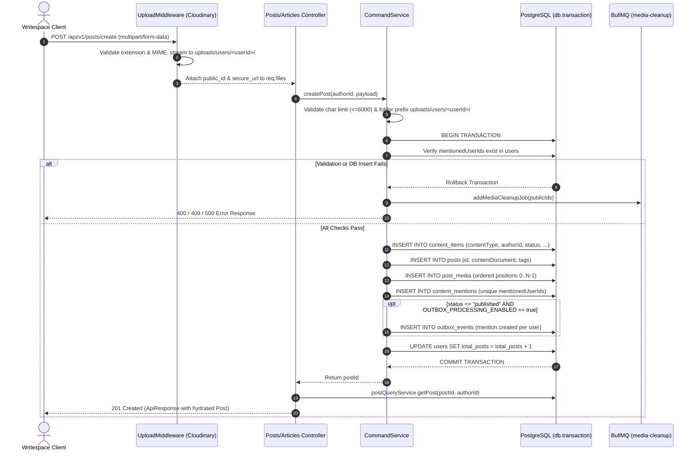
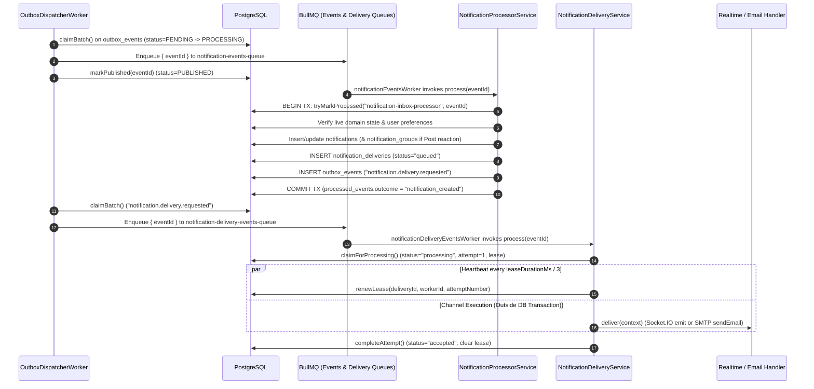
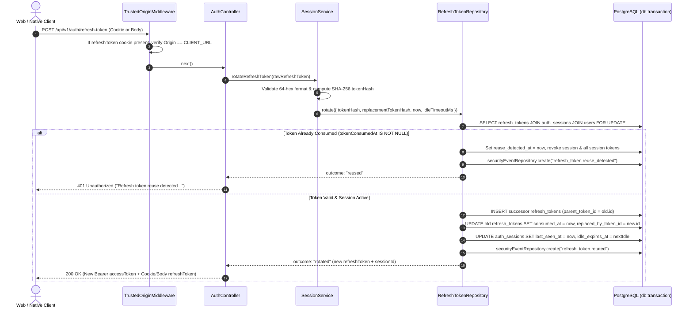

# Request & Event Data Flow

> **Purpose:** Trace the exact runtime sequence of synchronous HTTP mutations, transactional outbox handoffs, asynchronous delivery leases, and session token rotation.
> **Audience:** Internal backend developers debugging request lifecycles or concurrency behavior.
> **Prerequisites:** Read [Component Breakdown (C4 L3)](components.md).

## Overview

Writespace separates synchronous user-facing mutations from asynchronous external side effects. Every mutating HTTP request validates its inputs, executes relational changes and counter updates inside a single PostgreSQL transaction, and — when `OUTBOX_PROCESSING_ENABLED=true` — persists a domain event in `outbox_events` before committing. External side effects (Cloudinary asset deletion, Socket.IO emissions, and SMTP emails) happen outside the database transaction so external network latency or failures never hold PostgreSQL row locks open.

## Flow 1: Content creation, mention outbox & media cleanup on rollback

When a user creates a Post (`POST /api/v1/posts/create`) or an Article (`POST /api/v1/articles/create`) with uploaded images, Multer streams the files to Cloudinary _before_ the database transaction begins (`src/shared/middlewares/upload.middleware.ts`). If the database transaction subsequently fails (for example, due to a duplicate Article `slug` or a nonexistent mentioned user UUID), the command service catches the error and enqueues the newly uploaded Cloudinary `publicId` values into `media-cleanup` so no orphaned files remain in cloud storage (`src/modules/posts/services/post-command.service.ts`, `src/modules/articles/services/article-command.service.ts`).

**Diagram: Synchronous Content Creation & Media Cleanup on Rollback**

## Flow 2: Two-stage transactional outbox to channel delivery

When a domain operation records an event in `outbox_events`, the durable notification pipeline processes it in two distinct outbox stages (`src/modules/notification/services/`):

- **Stage 1 (Domain Event → Inbox & Delivery Request):** `outboxDispatcherWorker` claims the domain event (e.g., `reaction.added`, `comment.created`, `auth.security_alert`) and enqueues `{ eventId }` into `notification-events-queue`. `notificationEventsWorker` calls `notificationProcessorService.process(eventId)`, which atomically records idempotency in `processed_events`, creates/updates the `notifications` and `notification_groups` rows, inserts a `queued` row into `notification_deliveries`, and inserts a second outbox event named `notification.delivery.requested` into `outbox_events`.
- **Stage 2 (Delivery Request → Channel Handler):** `outboxDispatcherWorker` claims the `notification.delivery.requested` outbox row and enqueues `{ eventId }` into `notification-delivery-events-queue`. `notificationDeliveryEventsWorker` calls `notificationDeliveryService.process(eventId)`, which claims a worker lease on `notification_deliveries`, runs a lease-renewal heartbeat (`leaseDurationMs / 3`), invokes `notificationRealtimeHandler` or `notificationEmailHandler` outside the DB transaction, and records the terminal outcome in `notification_delivery_attempts` and `notification_deliveries`.

**Diagram: Durable Outbox to Notification & Channel Delivery Flow**

## Flow 3: Refresh token rotation & reuse detection

When a client calls `POST /api/v1/auth/refresh-token`, `SessionService.rotateRefreshToken` hashes the incoming 64-hex-character token with SHA-256 and delegates to `RefreshTokenRepository.rotate` (`src/modules/sessions/refresh-token.repository.ts`).

**Diagram: Session Creation, Access Validation & Refresh Token Rotation**

## Key decisions & rationale

- **Why perform `bcrypt` hashing outside the database transaction in `resetPassword` and `updatePassword`?** In `AuthService.resetPassword` (`src/modules/auth/auth.service.ts`) and `UserService.updatePassword` (`src/modules/users/user.service.ts`), `await bcrypt.hash(password, 12)` is computed before opening `db.transaction(...)` and acquiring `FOR UPDATE` row locks on `auth_challenges` or `users`. This prevents CPU-intensive bcrypt hashing from holding database locks and blocking concurrent queries.
- **Why use BullMQ `moveToDelayed` + `DelayedError` in `notificationDeliveryEventsWorker`?** When a delivery fails transiently (`status === "RETRY_SCHEDULED"`) or is locked by another worker (`status === "WAITING"`), `notificationDeliveryEventsWorker` (`src/modules/notification/workers/notification-delivery-events.worker.ts`) calls `job.moveToDelayed(scheduledTimestamp, token)` and throws `new DelayedError()`. This reschedules the existing BullMQ job to the exact `nextAttemptAt` timestamp persisted in PostgreSQL without creating duplicate BullMQ jobs.

## Gotchas & edge cases

- **Password change race condition guard:** In `UserService.updatePassword` (`src/modules/users/user.service.ts`), because `bcrypt.compare` and `bcrypt.hash` run outside the transaction, the transaction re-reads `users` with `FOR UPDATE` and verifies `lockedUser.passwordHash === user.passwordHash`. If another request changed the password in the meantime, it aborts with `409 Conflict` (`"Your password has changed. Please try again."`).
- **Compacting `post_media.position` without violating the unique index:** When updating a Post's images in `PostCommandService.updatePost` (`src/modules/posts/services/post-command.service.ts`), retained media positions cannot be updated directly to `0..N-1` if an existing row already occupies one of those positions (`post_media_post_position_uidx`). The service first shifts all kept rows to `maxCurrentPosition + 10 + index` and then compacts them back to `0..N-1`.

## Related

- [Architecture Overview (C4 L1 & L2)](overview.md)
- [Component Breakdown (C4 L3)](components.md)
- [Background Jobs, Outbox & Queues](../backend/background-jobs-and-queues.md)
- [Authentication & Sessions](../modules/auth.md)

---

_Last verified against: v1.0.0 (12bc4d7, documentation branch, 2026-11-17)_
