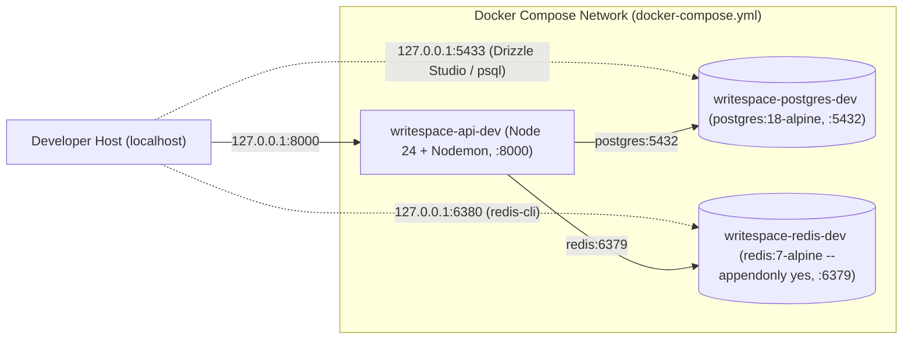
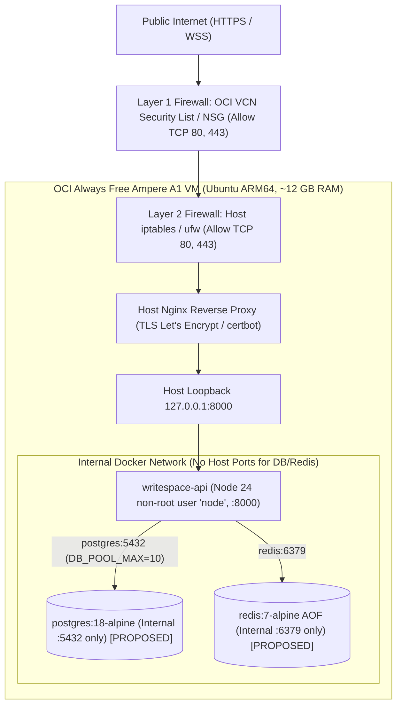

# Deployment Topology (Path A)

> **INTENDED — not yet running in production.**
> Derived from `docker-compose.prod.yml` plus the planned single-VM Oracle Cloud Always Free deployment (Path A). Verify against the live host after first deploy.

> **Purpose:** Define the container, network, reverse-proxy, and firewall topology for local development (`docker-compose.yml`) and the intended single-VM production environment (Path A).
> **Audience:** Internal developers and operations maintainers.
> **Prerequisites:** Read [Architecture Overview (C4 L1 & L2)](overview.md) and [Configuration & Environment Profiles](../getting-started/configuration.md).

## Overview

Writespace uses Docker Compose in both local development and its intended v1 production deployment:

1. **Local Development (`docker-compose.yml`):** Runs `writespace-api-dev`, `writespace-postgres-dev` (`postgres:18-alpine`), and `writespace-redis-dev` (`redis:7-alpine`) on the developer's machine, binding the API to `127.0.0.1:8000`, PostgreSQL to `127.0.0.1:5433`, and Redis to `127.0.0.1:6380`.
2. **Intended v1 Production — Path A (`docker-compose.prod.yml` + Path A co-located stores):** Runs the entire stack on **one Oracle Cloud Infrastructure (OCI) Always Free Ampere A1 (ARM64) VM** (~12 GB RAM allocation). Host-level Nginx terminates TLS (Let's Encrypt / `certbot`) on ports `80`/`443` and proxies to the API container bound strictly to loopback `127.0.0.1:8000`. PostgreSQL and Redis run as sibling containers on the internal Docker bridge network with **zero published host ports**.

## 1. Local development topology (`docker-compose.yml`)

**Diagram: Local Development Docker Compose Topology**



In development: `./src`, `./logs`, and `./uploads` are bind-mounted into `/app/src`, `/app/logs`, and `/app/uploads` (`docker-compose.yml`). `depends_on` waits for `postgres` (`pg_isready`) and `redis` (`redis-cli ping`) healthchecks before starting `npm run dev -- --legacy-watch --ext ts,js,json --signal SIGTERM`.

## 2. Intended production topology — Path A (OCI Ampere A1 Single-VM)

**Diagram: Intended Single-VM Production Topology (Path A)**



## Current `docker-compose.prod.yml` vs. Path A requirements

As committed in the repository today, `docker-compose.prod.yml` defines only the `api` service (`writespace-api:production`) and named volumes `api_logs` and `api_uploads`, expecting external PostgreSQL and Redis URLs in `.env.production`.

To deploy Path A (all services on the single OCI Ampere A1 VM), `postgres` and `redis` services must be added to `docker-compose.prod.yml` (or a `docker-compose.prod.override.yml`) before first deploy:



```yaml
# [PROPOSED — not in current source]
# Co-located PostgreSQL 18 and Redis 7 for Path A single-VM deployment.
# CRITICAL: Do NOT add a `ports:` section to postgres or redis in production.
services:
  api:
    depends_on:
      postgres:
        condition: service_healthy
      redis:
        condition: service_healthy
    # TODO(ops): decide final memory limit before first deploy
    mem_limit: 2g

  postgres:
    image: postgres:18-alpine
    container_name: writespace-postgres-prod
    restart: unless-stopped
    env_file:
      - .env.production
    volumes:
      - postgres_data_v18:/var/lib/postgresql
    healthcheck:
      test:
        ["CMD-SHELL", 'pg_isready -U "$${POSTGRES_USER}" -d "$${POSTGRES_DB}"']
      interval: 10s
      timeout: 5s
      retries: 5
    # TODO(ops): decide final memory limit and shared_buffers before first deploy
    mem_limit: 4g

  redis:
    image: redis:7-alpine
    container_name: writespace-redis-prod
    restart: unless-stopped
    command: ["redis-server", "--appendonly", "yes"]
    volumes:
      - redis_data:/data
    healthcheck:
      test: ["CMD", "redis-cli", "ping"]
      interval: 10s
      timeout: 3s
      retries: 5
    # TODO(ops): decide final memory limit and maxmemory policy before first deploy
    mem_limit: 1g

volumes:
  postgres_data_v18:
  redis_data:
```



## Architectural consequences of Path A

- **PgBouncer is deferred ([ADR-0009](../decisions/ADR-0009-defer-pgbouncer-single-vm.md)):** Although `drizzle.config.ts` comments mention bypassing PgBouncer via `DATABASE_DIRECT_URL`, Path A runs a single `writespace-api` container (`DB_POOL_MAX=10`) talking to a co-located PostgreSQL container over the local Docker bridge. PgBouncer is unnecessary at this scale and is deferred until horizontal API scaling is required (see ADR-0009). Both `DATABASE_URL` and `DATABASE_DIRECT_URL` point to `postgresql://...@postgres:5432/writespace` in Path A.
- **Internal-only database and Redis network exposure:** In `docker-compose.yml` (development), PostgreSQL and Redis bind to `127.0.0.1:5433` and `127.0.0.1:6380` for local tooling (`drizzle-kit studio`). In Path A production, `postgres` and `redis` must **never** publish host ports — they are reachable exclusively by service name (`postgres:5432`, `redis:6379`) inside the Docker network.
- **ARM64 multi-arch build requirement:** Oracle Ampere A1 instances use the `linux/arm64` architecture. While `postgres:18-alpine`, `redis:7-alpine`, and `node:24-bookworm-slim` publish official multi-arch manifests, building `writespace-api:production` on an `x86_64` workstation without `--platform linux/amd64,linux/arm64` will fail at container startup on A1 with `exec format error` (see [Build & Manual Deployment Workflow](../operations/ci-cd.md)).
- **Dual-layer OCI firewall rules:** Oracle Cloud Ubuntu images block TCP `80` and `443` in both the VCN Security List / Network Security Group (NSG) **and** the VM's host `iptables`. Both layers must be opened or Nginx will appear healthy locally while timing out externally (see [First Deploy on OCI Ampere A1](../operations/runbooks/first-deploy.md)).
- **Reverse proxy hop configuration:** Because host Nginx sits in front of `127.0.0.1:8000`, `.env.production` must set `TRUST_PROXY_HOPS=1` so `app.set("trust proxy", env.TRUST_PROXY_HOPS)` (`src/app.ts`) resolves the real client IP for `express-rate-limit` and `auth_sessions` audit logging.

## Key decisions & rationale

- **Why bind the production API container to `127.0.0.1:${HOST_PORT:-8000}:8000`?** Binding explicitly to `127.0.0.1` in `docker-compose.prod.yml` prevents Docker's `DOCKER-USER` `iptables` chain from exposing port `8000` directly on the VM's public network interface, forcing all external traffic through host Nginx TLS termination.
- **Why run as non-root `USER node` in `Dockerfile` production stage?** The `production` target in `Dockerfile` runs `npm ci --omit=dev`, copies only compiled `./dist`, `chown`s `logs` and `uploads` to `node:node`, and drops privileges to `USER node` before executing `node dist/server.js`.

## Gotchas & edge cases

- **Single point of failure:** A single OCI VM provides no high availability or automatic failover; host OS patching or container restarts cause brief downtime. See [Resource Budgeting, Performance & Scaling](../operations/performance-and-scaling.md) and [ADR-0010](../decisions/ADR-0010-path-a-to-path-b-migration.md) for the migration path to external managed services (Path B).
- **Pre-deploy `TODO(ops)` items:** OS image selection, DNS registrar/Cloudflare setup, container `mem_limit` values, and nightly `pg_dump` retention windows must be finalized before first deploy — see [Environments](../operations/environments.md) and [First Deploy Runbook](../operations/runbooks/first-deploy.md).

## Related

- [Environments (Local vs. OCI Single-VM)](../operations/environments.md)
- [First Deploy on OCI Ampere A1 (Path A)](../operations/runbooks/first-deploy.md)
- [ADR-0009: Defer PgBouncer in Single-VM Topology (Path A)](../decisions/ADR-0009-defer-pgbouncer-single-vm.md)
- [ADR-0010: Single-VM (Path A) to Managed Services (Path B) Migration Strategy](../decisions/ADR-0010-path-a-to-path-b-migration.md)

---

_Last verified against: v1.0.0 (12bc4d7, documentation branch, 2026-11-17)_
