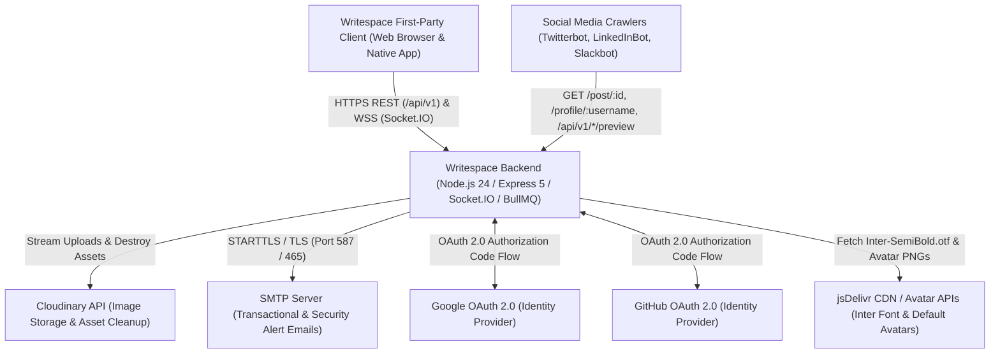
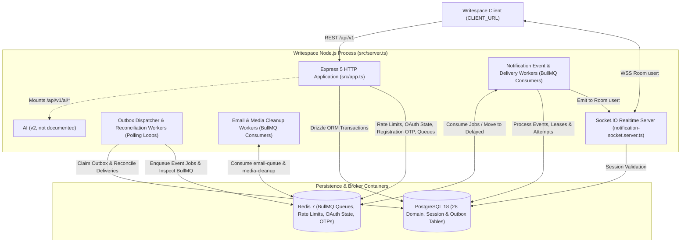

# Architecture Overview (C4 L1 & L2)

> **Purpose:** Illustrate Writespace's external system boundaries (C4 Level 1) and internal runtime containers and data stores (C4 Level 2).
> **Audience:** Internal backend developers, client integrators, and operations maintainers.
> **Prerequisites:** Read [System Mental Model](../concepts/overview.md).

## Overview

Writespace (`writespace-backend`) is architected as a **single-process modular monolith** written in TypeScript on Node.js 24 (`Dockerfile`, `src/server.ts`). A single runtime process hosts the Express 5 REST API (`/api/v1`), the authenticated Socket.IO real-time notification server, the BullMQ queue workers (`emailWorker`, `mediaWorker`, `notificationEventsWorker`, `notificationDeliveryEventsWorker`), and the scheduled PostgreSQL polling loops (`outboxDispatcherWorker`, `notificationReconciliationWorker`).

State is persisted across two backing stores: **PostgreSQL 18** (relational domain data, sessions, transactional outbox, and notification leases) and **Redis 7** (BullMQ job queues, IP and email rate-limit counters, OAuth2 state bindings, and pending registration OTPs).

## C4 Level 1 — System context

At the system context level, the Writespace backend serves the first-party Writespace web and native client (`CLIENT_URL`) and responds to social-media crawlers requesting Open Graph previews, while integrating with Cloudinary, an SMTP relay, and Google/GitHub OAuth2 providers.

**Diagram: C4 Level 1 System Context**

## External actors & integrations

| Actor / External System          | Direction     | Protocol / Auth                                                                                                                     | Source Implementation                                                                                           |
| :------------------------------- | :------------ | :---------------------------------------------------------------------------------------------------------------------------------- | :-------------------------------------------------------------------------------------------------------------- |
| Writespace Web / Native Client   | Inbound       | HTTPS REST (`/api/v1/*`) + WSS Socket.IO (`handshake.auth.token`)                                                                   | `src/app.ts`, `src/routes/index.ts`, `src/modules/notification/realtime/notification-socket.server.ts`          |
| Social Media Crawlers            | Inbound       | HTTP `GET /post/:id`, `GET /profile/:username`, `GET /api/v1/posts/public/:id/preview`, `GET /api/v1/articles/public/:slug/preview` | `src/shared/middlewares/bot-interceptor.middleware.ts`, `post-preview.service.ts`, `article-preview.service.ts` |
| Cloudinary                       | Outbound      | HTTPS (`cloudinary.v2` SDK with `CLOUDINARY_API_KEY` / `CLOUDINARY_API_SECRET`)                                                     | `src/shared/middlewares/upload.middleware.ts`, `src/shared/queues/media.worker.ts`                              |
| SMTP Server                      | Outbound      | SMTP with `requireTLS: true` (`SMTP_HOST`, `SMTP_PORT`, `SMTP_USER`, `SMTP_PASS`)                                                   | `src/shared/infra/mailer.ts`, `src/shared/queues/email.worker.ts`, `notification-email.handler.ts`              |
| Google & GitHub OAuth 2.0        | Bidirectional | OAuth 2.0 redirect + callback (`/api/v1/auth/google/callback`, `/api/v1/auth/github/callback`) with Redis state store               | `src/modules/auth/auth.utils.ts`, `src/modules/auth/oauth-state.store.ts`                                       |
| jsDelivr / DiceBear / UI-Avatars | Outbound      | HTTPS `fetch` for `Inter-SemiBold.otf` (cached in memory) and avatar PNG rendering in Satori                                        | `src/shared/utils/og-generator.ts`                                                                              |

## C4 Level 2 — Container architecture

Within the Writespace boundary, the Node.js application process coordinates synchronous HTTP/WebSocket handling and asynchronous background workers over PostgreSQL 18 and Redis 7.

**Diagram: C4 Level 2 Container Architecture**

## Container breakdown

| Logical Container                              | Entry Point / Location                                                                                     | Technology                                                               | Responsibilities                                                                                                                                                                |
| :--------------------------------------------- | :--------------------------------------------------------------------------------------------------------- | :----------------------------------------------------------------------- | :------------------------------------------------------------------------------------------------------------------------------------------------------------------------------ |
| **Express 5 HTTP Application**                 | `src/app.ts`, `src/routes/index.ts`                                                                        | Express `^5.2.1`, Helmet, CORS, Passport, Multer, Zod                    | Serves `/health`, `/uploads`, crawler Open Graph HTML, and all first-party `/api/v1/*` REST endpoints.                                                                          |
| **Socket.IO Realtime Server**                  | `src/modules/notification/realtime/notification-socket.server.ts`                                          | `socket.io` `^4.8.4`                                                     | Authenticates WebSocket handshakes (HS256 JWT + active session check), joins sockets to `user:<id>`, and emits `notification.*` events.                                         |
| **Outbox Dispatcher & Reconciliation Workers** | `src/modules/notification/workers/outbox-dispatcher.worker.ts`, `notification-reconciliation.worker.ts`    | Custom `setTimeout` polling loops                                        | Polls `outbox_events` (`1000ms` default) to enqueue BullMQ jobs, and polls `notification_deliveries` (`15000ms` default) to repair missing/failed jobs and expire stale leases. |
| **Notification Event & Delivery Workers**      | `src/modules/notification/workers/notification-events.worker.ts`, `notification-delivery-events.worker.ts` | BullMQ `^5.66.4` Worker                                                  | Consumes `notification-events-queue` and `notification-delivery-events-queue` (concurrency `10` default) to build inbox items and execute realtime/email deliveries.            |
| **Email & Media Cleanup Workers**              | `src/shared/queues/email.worker.ts`, `media.worker.ts`                                                     | BullMQ `^5.66.4` Worker                                                  | Consumes `email-queue` (transactional auth/account emails, concurrency `5`) and `media-cleanup` (Cloudinary asset deletion, concurrency `5`).                                   |
| **AI (v2, not documented)**                    | `src/modules/ai/`, `src/shared/ai/`                                                                        | `@google/genai` `^2.27.0`                                                | Experimental v2 post-assistant feature; out of scope for v1 documentation (see [AI Integration (Gemini) — Coming in v2](../modules/ai.md)).                                     |
| **PostgreSQL 18**                              | `docker-compose.yml` (`postgres:18-alpine`), `src/db/index.ts`                                             | PostgreSQL 18 + `pg` Pool (min=2, max=10) + Drizzle ORM                  | Primary relational store for all 28 application tables and `drizzle.__drizzle_migrations`.                                                                                      |
| **Redis 7**                                    | `docker-compose.yml` (`redis:7-alpine`), `src/config/redis.ts`, `src/config/bullmq.ts`                     | Redis 7 (`--appendonly yes`), `redis` `^5.10.0` + `ioredis` (via BullMQ) | Stores BullMQ queues, `rate-limit-redis` counters (`rl:*`), OAuth states (`oauth:state:*`), and registration OTPs (`auth:register:*`).                                          |

## Key decisions & rationale

- **Co-locating workers and HTTP server in `src/server.ts`:** Running the HTTP server, Socket.IO server, and background workers in one Node.js process allows `NotificationRealtimeHandler` (`src/modules/notification/handlers/notification-realtime.handler.ts`) to call `getNotificationSocketServer().to(recipientRoom).emit(...)` directly in memory without requiring a Redis Socket.IO adapter in the single-VM Path A deployment.
- **Two Redis client libraries (`redis` v5 and `ioredis` v5):** Application code (`src/config/redis.ts`, `rate-limit.middleware.ts`, `oauth-state.store.ts`, `auth.service.ts`) uses the official `redis` (`^5.10.0`) client, while BullMQ (`^5.66.4`) internally uses `ioredis` configured via `bullmqRedisConnection` in `src/config/bullmq.ts`. Both parse the same `env.REDIS_URL` and `env.REDIS_PASSWORD`.

## Gotchas & edge cases

- **In-memory Socket.IO instance coupling:** Because `getNotificationSocketServer()` (`src/modules/notification/realtime/notification-socket.server.ts`) returns the process-local `activeSocketServer` singleton, `notificationDeliveryEventsWorker` must run in the same Node.js process as the Socket.IO server (or a `@socket.io/redis-adapter` must be added before splitting workers into separate containers).
- **Ordered LIFO shutdown in `src/server.ts`:** During `gracefulShutdown`, `outboxDispatcherWorker` and `notificationReconciliationWorker` are stopped before `notificationEventsWorker` and `notificationDeliveryEventsWorker` (achieved via `workers.unshift(...)` in `src/server.ts`), which in turn close before the BullMQ Queue instances, Redis connection, and PostgreSQL pool.

## Related

- [Component Breakdown (C4 L3)](components.md)
- [Request & Event Data Flow](data-flow.md)
- [Technology Stack & Rationale](tech-stack.md)
- [Deployment Topology (Path A)](deployment-topology.md)

---

_Last verified against: v1.0.0 (12bc4d7, documentation branch, 2026-11-17)_
