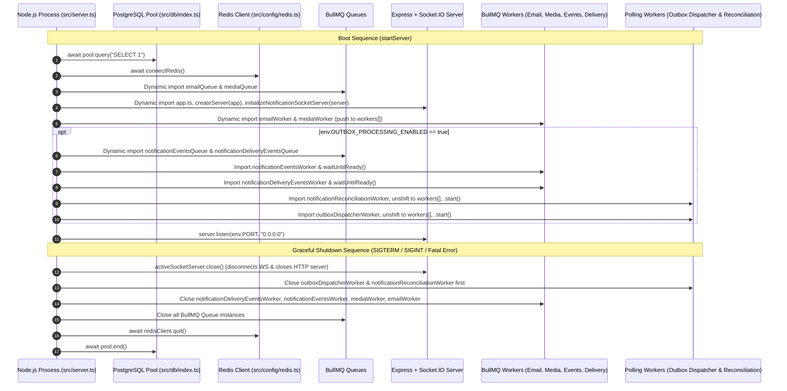

# Entry Points & Server Lifecycle

> **Purpose:** Document the exact initialization and shutdown sequences in `src/server.ts` and `src/app.ts`, including why modules are dynamically imported and why workers close in reverse order.
> **Audience:** Internal backend developers and operations maintainers.
> **Prerequisites:** Read [Project Tour](../getting-started/project-tour.md) and [Repository Structure](repository-structure.md).

## Overview

Writespace has two primary entry point files in `src/`:

- **`src/server.ts`**: The process entry point executed by `npm run dev` (`ts-node -r tsconfig-paths/register ./src/server.ts` in `nodemon.json`) and `npm start` (`node dist/server.js` in `package.json`). It owns database and Redis connectivity checks, queue and worker lifecycle, HTTP and Socket.IO server binding, process signal handlers, and `gracefulShutdown`.
- **`src/app.ts`**: The Express 5 application module dynamically imported by `src/server.ts` after PostgreSQL and Redis are connected.

## Startup & graceful shutdown sequence

**Diagram: Server Bootstrap & LIFO Graceful Shutdown Sequence**

## Detailed bootstrap steps (`src/server.ts`)

`startServer()` in `src/server.ts` uses dynamic `await import(...)` statements after connecting to PostgreSQL and Redis so that queue and route modules do not attempt operations before infrastructure connections are verified:

| Step                                 | Operation in `src/server.ts`                                                                                                                                                                                                                                                                                                                                                                                           | Failure Behavior                                                                                                                                                                              |
| ------------------------------------ | ---------------------------------------------------------------------------------------------------------------------------------------------------------------------------------------------------------------------------------------------------------------------------------------------------------------------------------------------------------------------------------------------------------------------- | --------------------------------------------------------------------------------------------------------------------------------------------------------------------------------------------- |
| **1. Env Validation**                | Static import of `env` from `./config/env` runs `envSchema.safeParse(process.env)`.                                                                                                                                                                                                                                                                                                                                    | Prints formatted Zod errors to stderr and exits immediately with code 1.                                                                                                                      |
| **2. PostgreSQL Check**              | `await pool.query("SELECT 1")` using `pool` from `./db`.                                                                                                                                                                                                                                                                                                                                                               | Logs `"Failed to start WriteSpace"` and runs `gracefulShutdown("Startup failure", 1)`.                                                                                                        |
| **3. Redis Connection**              | `await connectRedis()` using `client` from `./config/redis`.                                                                                                                                                                                                                                                                                                                                                           | Logs `"Failed to start WriteSpace"` and runs `gracefulShutdown("Startup failure", 1)`.                                                                                                        |
| **4. Core Queues**                   | Dynamically imports `emailQueue` (`./shared/queues/email.queue`) and `mediaQueue` (`./shared/queues/media.queue`) and pushes both to `queues[]`.                                                                                                                                                                                                                                                                       | Caught by startup `try` / `catch`; triggers `gracefulShutdown("Startup failure", 1)`.                                                                                                         |
| **5. HTTP & Socket.IO**              | Dynamically imports `./app`, calls `createServer(app)`, and calls `initializeNotificationSocketServer(server)`.                                                                                                                                                                                                                                                                                                        | Attaches WebSocket auth middleware (`io.use`) and connection handler (`user:<id>` room join).                                                                                                 |
| **6. Core Workers**                  | Dynamically imports `emailWorker` (`./shared/queues/email.worker`) and `mediaWorker` (`./shared/queues/media.worker`) and pushes both to `workers[]`.                                                                                                                                                                                                                                                                  | Workers connect to Redis via `bullmqRedisConnection` (`./config/bullmq`).                                                                                                                     |
| **7. Durable Notification Pipeline** | Executed only if `env.OUTBOX_PROCESSING_ENABLED` is `true`: imports `notificationEventsQueue` and `notificationDeliveryEventsQueue`; imports `notificationEventsWorker` and `notificationDeliveryEventsWorker` and awaits `.waitUntilReady()` on each; imports `notificationReconciliationWorker` and `outboxDispatcherWorker`, prepends them to `workers[]` via `workers.unshift(...)`, and calls `.start()` on both. | If `OUTBOX_PROCESSING_ENABLED` is `false`, logs warning: `"Durable notification event processing is disabled. New events will remain pending in PostgreSQL until the dispatcher is enabled."` |
| **8. Port Bind**                     | `server.listen(env.PORT, "0.0.0.0")`                                                                                                                                                                                                                                                                                                                                                                                   | Logs `"Server is running on port ${env.PORT}"`.                                                                                                                                               |

## Signal handling & gracefulShutdown order

`src/server.ts` registers five process/server listeners that invoke `gracefulShutdown(reason, exitCode)`:

- `SIGTERM` → `exitCode = 0` (sent by `docker stop` and Nodemon `--signal SIGTERM`)
- `SIGINT` → `exitCode = 0` (Ctrl+C in terminal)
- `server.on("error")` → `exitCode = 1`
- `process.on("uncaughtException")` → `exitCode = 1`
- `process.on("unhandledRejection")` → `exitCode = 1`

When `gracefulShutdown` begins:

1. **Idempotency guard:** Sets `isShuttingDown = true`. Subsequent signals log `Shutdown already in progress, ignoring "<reason>"` and return early.
2. **Force-exit watchdog timer:** Starts a `setTimeout` for `env.SHUTDOWN_TIMEOUT_MS` (120000ms / 2 minutes by default) and calls `forceExit.unref()` so the timer itself does not keep the event loop alive. If shutdown hangs past `SHUTDOWN_TIMEOUT_MS`, it logs `"Graceful shutdown timed out, forcing exit"` and calls `process.exit(1)`.
3. **Socket.IO & HTTP server close:** If `notificationSocketServer` is initialized, it calls `activeSocketServer.close()`, which disconnects all Socket.IO clients and closes the underlying Node `http.Server`. Only if startup failed before Socket.IO initialized does it fall back to `server.close()`.
4. **Workers close (`workers[]` array order):** Because `notificationReconciliationWorker` and `outboxDispatcherWorker` were added with `workers.unshift(...)`, the loop closes resources in this exact order:
   - `Outbox dispatcher` (stops polling PostgreSQL and awaits any active `dispatchBatch`)
   - `Notification reconciliation worker` (stops polling and awaits any active `reconcile` cycle)
   - `Email worker`
   - `Media worker`
   - `Notification events worker`
   - `Notification delivery events worker`
5. **Queues close (`queues[]` array order):** `Closes Email queue`, `Media queue`, `Notification events queue`, and `Notification delivery events queue`.
6. **Data store connections close:** If `redisClient.isOpen`, calls `redisClient.quit()`. Then calls `pool.end()` to drain the PostgreSQL connection pool.
7. **Exit:** Clears `forceExit` and calls `process.exit(shutdownFailed ? 1 : exitCode)`.

## Key decisions & rationale

- **Why stop `outboxDispatcherWorker` and `notificationReconciliationWorker` before BullMQ consumers?** If the BullMQ consumers (`notificationEventsWorker`, `notificationDeliveryEventsWorker`) closed first while the outbox dispatcher or reconciliation worker was still running a cycle, the polling loops would enqueue new jobs into Redis while the process was shutting down. Using `workers.unshift(...)` in `src/server.ts` guarantees that job producers stop before job consumers drain.

- **Why wait for `waitUntilReady()` on notification consumers before starting the dispatcher?** During startup (`src/server.ts`), `await notificationEventsWorker.waitUntilReady()` and `await notificationDeliveryEventsWorker.waitUntilReady()` complete before `notificationReconciliationWorker.start()` and `outboxDispatcherWorker.start()` are called, ensuring consumers are ready before any outbox batch is dispatched.

## Gotchas & edge cases

- **`stop_grace_period` vs. `SHUTDOWN_TIMEOUT_MS`:** Both `docker-compose.yml` and `docker-compose.prod.yml` set `stop_grace_period: 30s`, whereas `SHUTDOWN_TIMEOUT_MS` defaults to `120000` (120s) in `src/config/env.ts` and `.env.example`. When `docker compose down` or `docker stop` runs, Docker will send `SIGKILL` after 30 seconds if `gracefulShutdown` has not finished, before the 120-second Node.js watchdog timer fires.

- **Single initialization guard on Socket.IO:** `initializeNotificationSocketServer` (`src/modules/notification/realtime/notification-socket.server.ts`) stores the server in a module-scoped `activeSocketServer` variable and throws `500 Internal Server Error` (`"Notification Socket.IO server is already initialized."`) if called more than once in the same process.

## Related

- [Project Tour](../getting-started/project-tour.md)
- [Repository Structure](./repository-structure.md)
- [Background Jobs, Outbox & Queues](../backend/background-jobs-and-queues.md)

_Last verified against: v1.0.0 (b97c4fa, documentation branch, 2026-11-17)_
