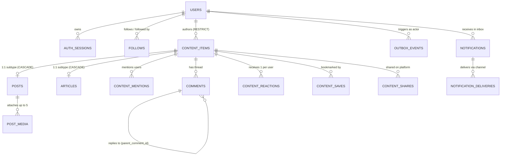

# Domain Model & Entities

> **Purpose:** Map the core domain entities, their cardinalities, ownership rules, and lifecycle states across Writespace's four bounded contexts.
> **Audience:** Internal backend developers and database maintainers.
> **Prerequisites:** Read [System Mental Model](overview.md).

## Overview

The Writespace domain is persisted across 28 PostgreSQL tables defined in `src/db/schema/` and `drizzle/0000_initial_schema.sql`. To keep the domain model comprehensible, entities are grouped into four bounded contexts:

1. **Identity, Sessions & Security** (`users`, `follows`, `auth_identities`, `auth_sessions`, `refresh_tokens`, `auth_challenges`, `security_events`)
2. **Shared Content & Publishing** (`content_items`, `posts`, `articles`, `post_media`, `content_mentions`)
3. **Social Interactions** (`comments`, `content_reactions`, `comment_reactions`, `content_saves`, `content_shares`, `interaction_events`)
4. **Durable Outbox & Notifications** (`outbox_events`, `processed_events`, `notifications`, `notification_groups`, `notification_group_events`, `notification_preferences`, `notification_user_settings`, `notification_deliveries`, `notification_delivery_attempts`, `notification_suppressions`)

## Core domain entity-relationship diagram

The diagram below shows the 15 primary domain entities and how they anchor to `USERS` and `CONTENT_ITEMS`. (Full 28-table split ER diagrams with all columns and indexes are documented in [Database Schema Reference](../data/schema.md).)

**Diagram: High-Level Core Domain Model**

## Bounded context 1: Identity, sessions & social graph

| Entity (Table)                        | Schema File                        | Primary Key                   | Lifecycle / Status Values                                                              | Role in the Domain                                                                                                                                                            |
| :------------------------------------ | :--------------------------------- | :---------------------------- | :------------------------------------------------------------------------------------- | :---------------------------------------------------------------------------------------------------------------------------------------------------------------------------- |
| **User** (`users`)                    | `src/db/schema/users.ts`           | `id` (uuid)                   | `status`: `active`, `suspended`, `banned`; `role`: `user`, `admin`                     | Root account profile, social links, OAuth flags, and denormalized profile counters (`total_posts`, `total_reads`, `total_followers`, `total_following`).                      |
| **Follow** (`follows`)                | `src/db/schema/follows.ts`         | `(follower_id, following_id)` | Present or deleted                                                                     | Directed user-to-user follow edge. Self-follows are rejected by `FollowService` (`src/modules/interactions/services/follow.service.ts`).                                      |
| **AuthIdentity** (`auth_identities`)  | `src/db/schema/auth-identities.ts` | `id` (uuid)                   | `provider`: `password`, `google`, `github`                                             | Links an authentication credential (`password_hash` or immutable OAuth `provider_subject`) to a user.                                                                         |
| **AuthSession** (`auth_sessions`)     | `src/db/schema/auth-sessions.ts`   | `id` (uuid)                   | Active (`revoked_at IS NULL` & unexpired) or Revoked                                   | Server-managed login session tracking `client_type` (`web`, `native`), `assurance_level` (`1..3`), `idle_expires_at`, and `absolute_expires_at`.                              |
| **RefreshToken** (`refresh_tokens`)   | `src/db/schema/refresh-tokens.ts`  | `id` (uuid)                   | Active, Consumed (`consumed_at`), Revoked (`revoked_at`), Reused (`reuse_detected_at`) | Stores SHA-256 `token_hash` and rotation lineage (`parent_token_id`, `replaced_by_token_id`) for a session.                                                                   |
| **AuthChallenge** (`auth_challenges`) | `src/db/schema/auth-challenges.ts` | `id` (uuid)                   | `purpose`: `registration`, `email_verification`, `password_reset`, `email_change`      | Stores hashed one-time secrets (`secret_hash`) and attempt budgets (`attempts` / `max_attempts`).                                                                             |
| **SecurityEvent** (`security_events`) | `src/db/schema/security-events.ts` | `id` (uuid)                   | `outcome`: `success`, `detected`                                                       | Durable security audit log (`session.created`, `auth.login`, `password.reset`, `refresh_token.reuse_detected`, etc.) that survives account deletion (`onDelete: "set null"`). |

## Bounded context 2: Shared content & publishing

| Entity (Table)                          | Schema File                         | Primary Key                          | Lifecycle / Status Values                                                      | Role in the Domain                                                                                                                                                                     |
| :-------------------------------------- | :---------------------------------- | :----------------------------------- | :----------------------------------------------------------------------------- | :------------------------------------------------------------------------------------------------------------------------------------------------------------------------------------- |
| **ContentItem** (`content_items`)       | `src/db/schema/content-items.ts`    | `id` (uuid)                          | `content_type`: `post`, `article`; `status`: `draft`, `scheduled`, `published` | Canonical identity, lifecycle state, optimistic concurrency `version`, and engagement counters for all publishable content.                                                            |
| **Post** (`posts`)                      | `src/db/schema/posts.ts`            | `id` (uuid FK to `content_items.id`) | Inherited from `content_items`                                                 | Short-form update (`<= 6,000` visible chars) storing JSONB `content_document` and up to 5 tags.                                                                                        |
| **Article** (`articles`)                | `src/db/schema/articles.ts`         | `id` (uuid FK to `content_items.id`) | Inherited from `content_items`                                                 | Long-form technical post with `title` (5–200 chars), unique `slug` (`<= 250` chars), `subtitle`, `excerpt`, `read_time`, `tags`, `content_document`, and optional cover image columns. |
| **PostMedia** (`post_media`)            | `src/db/schema/post-media.ts`       | `id` (uuid)                          | Attached or deleted                                                            | Up to 5 ordered image attachments (`position 0..4`) belonging to a `posts` row.                                                                                                        |
| **ContentMention** (`content_mentions`) | `src/db/schema/content-mentions.ts` | `id` (uuid)                          | Synchronized on document save                                                  | Unique `(content_item_id, mentioned_user_id)` lookup table extracted from `mention` inline nodes in `ContentDocument`.                                                                 |

## Bounded context 3: Social interactions

| Entity (Table)                              | Schema File                           | Primary Key                  | Constraints / Vocabulary                                                         | Role in the Domain                                                                                                                                           |
| :------------------------------------------ | :------------------------------------ | :--------------------------- | :------------------------------------------------------------------------------- | :----------------------------------------------------------------------------------------------------------------------------------------------------------- |
| **Comment** (`comments`)                    | `src/db/schema/comments.ts`           | `id` (uuid)                  | `content` (1–2500 chars), `is_edited`, `reaction_count`, `reply_count`           | Top-level comments (`parent_comment_id IS NULL`) and nested replies (`parent_comment_id` self-FK) on a published `content_items` row.                        |
| **ContentReaction** (`content_reactions`)   | `src/db/schema/content-reactions.ts`  | `(content_item_id, user_id)` | `reaction_type`: `like`, `love`, `laugh`, `celebrate`, `support`, `sad`, `angry` | Current reaction by a user on a Post or Article (at most one per user per content item).                                                                     |
| **CommentReaction** (`comment_reactions`)   | `src/db/schema/comment-reactions.ts`  | `(comment_id, user_id)`      | Same 7 `reaction_type` enum values                                               | Current reaction by a user on a comment.                                                                                                                     |
| **ContentSave** (`content_saves`)           | `src/db/schema/content-saves.ts`      | `(content_item_id, user_id)` | Composite PK prevents duplicates                                                 | User bookmark of a Post or Article.                                                                                                                          |
| **ContentShare** (`content_shares`)         | `src/db/schema/content-shares.ts`     | `id` (serial)                | Append-only (multiple shares allowed)                                            | Records each platform share action (`linkedin`, `x`, `whatsapp`, `facebook`, `reddit`, `telegram`, `bluesky`, `pinterest`, `email`, `generic`, `copy_link`). |
| **InteractionEvent** (`interaction_events`) | `src/db/schema/interaction-events.ts` | `id` (serial)                | `target_type`: `CONTENT_ITEM`, `COMMENT`, `USER`                                 | Best-effort historical log of reaction, follow, save, and share actions.                                                                                     |

## Bounded context 4: Durable outbox & notifications

| Entity (Table)                                                     | Schema File                                       | Primary Key                    | Lifecycle / Status Values                                                                                                         | Role in the Domain                                                                                                         |
| :----------------------------------------------------------------- | :------------------------------------------------ | :----------------------------- | :-------------------------------------------------------------------------------------------------------------------------------- | :------------------------------------------------------------------------------------------------------------------------- |
| **OutboxEvent** (`outbox_events`)                                  | `src/db/schema/outbox-events.ts`                  | `id` (uuid)                    | `status`: `PENDING`, `PROCESSING`, `PUBLISHED`, `FAILED`                                                                          | Transactional outbox table storing 12 domain event types plus `notification.delivery.requested` with worker lease columns. |
| **ProcessedEvent** (`processed_events`)                            | `src/db/schema/processed-events.ts`               | `(consumer_name, event_id)`    | `outcome`: `processing`, `notification_created`, `group_updated`, `expired`, `no_delivery_required`                               | Idempotency ledger ensuring each consumer processes an `event_id` at most once.                                            |
| **Notification** (`notifications`)                                 | `src/db/schema/notifications.ts`                  | `id` (uuid)                    | `status`: `active`, `archived`, `dismissed`; `priority`: `critical`, `high`, `normal`, `low`                                      | Persistent in-app notification inbox item with `read_at` and soft-delete `deleted_at` timestamps.                          |
| **NotificationGroup** (`notification_groups`)                      | `src/db/schema/notification-groups.ts`            | `id` (uuid)                    | `status`: `active`, `closed`                                                                                                      | Aggregates rapid activity (such as Post reactions within a 5-minute UTC window) into one inbox presentation.               |
| **NotificationGroupEvent** (`notification_group_events`)           | `src/db/schema/notification-group-events.ts`      | `id` (uuid)                    | Unique `(group_id, source_event_id)`                                                                                              | Tracks individual source events and actors contributing to a `notification_groups` aggregate.                              |
| **NotificationPreference** (`notification_preferences`)            | `src/db/schema/notification-preferences.ts`       | `(user_id, category, channel)` | `channel`: `in_app`, `email`, `browser_push`; `frequency`: `immediate`, `daily_digest`, `weekly_digest`                           | Stores user overrides on top of `notification-policy.registry.ts` defaults.                                                |
| **NotificationUserSettings** (`notification_user_settings`)        | `src/db/schema/notification-user-settings.ts`     | `user_id` (uuid)               | `quiet_hours_enabled` (boolean)                                                                                                   | Per-user IANA timezone and local wall-clock quiet hours (`quiet_hours_start <> quiet_hours_end`).                          |
| **NotificationDelivery** (`notification_deliveries`)               | `src/db/schema/notification-deliveries.ts`        | `id` (uuid)                    | `queued`, `processing`, `accepted`, `delivered`, `retryable_failed`, `permanent_failed`, `suppressed`, `unknown`, `dead_lettered` | Tracks one logical channel delivery request with independent worker lease and reconciliation lease state.                  |
| **NotificationDeliveryAttempt** (`notification_delivery_attempts`) | `src/db/schema/notification-delivery-attempts.ts` | `id` (uuid)                    | `processing`, `accepted`, `delivered`, `transient_failure`, `permanent_failure`, `ambiguous`, `suppressed`                        | Per-attempt diagnostic record storing `attempt_number`, `latency_ms`, `error_code`, and `provider_message_id`.             |
| **NotificationSuppression** (`notification_suppressions`)          | `src/db/schema/notification-suppressions.ts`      | `id` (uuid)                    | `channel`: `email`, `browser_push`                                                                                                | Suppresses deliveries to bounced or blocked destinations using a keyed `destination_fingerprint`.                          |

## Key decisions & rationale

- **Foreign key delete behaviors (`RESTRICT` vs. `CASCADE` vs. `SET NULL`):**
  - `content_items.author_id` and `comments.author_id` use `ON DELETE RESTRICT` so user accounts with authored content cannot be hard-deleted accidentally (`src/db/schema/content-items.ts`, `comments.ts`).
  - Subtype and interaction tables (`posts`, `articles`, `post_media`, `comments`, `content_reactions`, `comment_reactions`, `content_saves`, `content_shares`, `content_mentions`) use `ON DELETE CASCADE` so deleting a `content_items` row cleanly removes all dependent records in one database operation (`src/modules/posts/services/post-command.service.ts`).
  - Operational and audit tables (`security_events`, `outbox_events`, `notification_deliveries`, `notifications.actor_user_id`, `notification_group_events.actor_user_id`) use `ON DELETE SET NULL` so security and delivery history remain intact even if an actor or recipient row is removed.
- **Deliberate omission of foreign keys on cross-module / cross-retention references:** `processed_events.event_id`, `notifications.source_event_id`, `notification_deliveries.source_event_id`, `notification_group_events.source_event_id`, `notifications.resource_id`, and `interaction_events.target_id` intentionally omit foreign keys so polymorphic targets and independent retention schedules do not block cleanup (see [ADR-0003](../decisions/ADR-0003-transactional-outbox-and-idempotency.md)).

## Gotchas & edge cases

- **Database FK cannot enforce `content_type` discriminator match:** Because `posts.id` and `articles.id` are single-column foreign keys to `content_items.id`, PostgreSQL alone cannot prevent inserting a `posts` row whose parent `content_items.content_type` is `"article"`. Application services (`PostCommandService`, `ArticleCommandService`, `ReactionRepository`, `CommentRepository`, `SaveRepository`) always include `eq(contentItems.contentType, "post" | "article")` and verify subtype row existence.
- **Registration OTP challenges live in Redis, not `auth_challenges`:** While `auth_challenges` supports `"registration"` in its purpose check constraint (`src/db/schema/auth-challenges.ts`), `AuthService.initiateRegistration` (`src/modules/auth/auth.service.ts`) currently caches pending registration data and the HMAC-SHA256 `otpHash` in Redis under `auth:register:<email>` (TTL 600s) and uses `auth_challenges` in PostgreSQL for `"password_reset"` tokens.

## Related

- [System Mental Model](overview.md)
- [Glossary](glossary.md)
- [Database Schema Reference](../data/schema.md)
- [Posts & Articles (Shared Content)](../modules/content.md)

---

_Last verified against: v1.0.0 (12bc4d7, documentation branch, 2026-11-17)_
