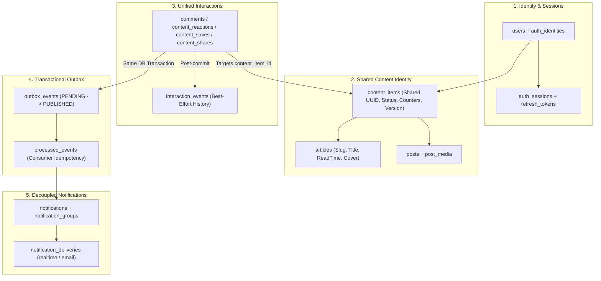

# System Mental Model

> **Purpose:** Establish the foundational mental model required to read, debug, and extend the Writespace backend without breaking cross-module invariants.
> **Audience:** Internal backend developers and first-party client integrators.
> **Prerequisites:** Read [Writespace Engineering Documentation](../README.md) and [Project Tour](../getting-started/project-tour.md).

## Overview

Writespace is a social blogging backend built around a single guiding principle: **unify shared identity and infrastructure at the database boundary while keeping content-specific and channel-specific rules modular**. Instead of building separate comment trees, reaction tables, bookmark lists, and notification pipelines for short-form Posts and long-form Articles, Writespace anchors both formats to a shared `content_items` parent table (`src/db/schema/content-items.ts`).

Every state-changing operation in the system follows predictable transactional boundaries. Synchronous HTTP requests mutate primary relational state, update denormalized counters, and record durable domain events in `outbox_events` within a single PostgreSQL transaction. Asynchronous background workers then consume those outbox events using expiring database leases to update in-app notification inboxes, push real-time Socket.IO updates, and dispatch emails via SMTP.

## The five pillars of Writespace

**Diagram: Writespace Core Mental Model**

### 1. Shared content identity (`content_items`)

In Writespace, a Post (`src/db/schema/posts.ts`) and an Article (`src/db/schema/articles.ts`) are subtypes of `content_items` (`src/db/schema/content-items.ts`):

- **1:1 shared UUID:** `content_items.id` is generated first (`defaultRandom()`). The child row in `posts` or `articles` uses that exact UUID as both its primary key and its foreign key (`onDelete: "cascade"`). There is never a separate `post_id` vs. `content_item_id` for the same piece of content.
- **Centralized lifecycle and counters:** `content_items` owns `contentType` (`"post"` or `"article"`), `authorId`, `status` (`"draft"`, `"scheduled"`, `"published"`), `scheduledAt`, `publishDate`, `viewCount`, `reactionCount`, `commentCount`, `shareCount`, and the optimistic concurrency `version` counter.
- **Shared ContentDocument JSONB contract:** Both `posts.content_document` and `articles.content_document` store a versioned block document (`version: 1`) composed of `paragraph` blocks (containing `text`, `link`, and `mention` inline nodes) and `code` blocks (`src/db/schema/content-document.ts`).
- **Subtype specialization:** Posts enforce a 6,000-character visible text limit (`src/modules/posts/dtos/create-post.dto.ts`) and store up to 5 ordered image attachments in `post_media` (`src/db/schema/post-media.ts`). Articles have no 6,000-character limit, require a `title` and unique URL `slug`, calculate `readTime` at 200 words per minute (`src/modules/articles/domain/article-content.ts`), and store a single optional cover image directly on `articles`.

### 2. Unified social interactions & dual event recording

Because `content_items` provides a common identity, the `interactions` module (`src/modules/interactions/`) operates uniformly across Posts and Articles:

- **Shared relational targets:** `comments`, `content_reactions`, `content_saves`, `content_shares`, and `content_mentions` all reference `content_items.id` (`onDelete: "cascade"`).
- **Denormalized counters with row locking:** Parent rows in `users`, `content_items`, and `comments` maintain integer counters (`totalPosts`, `totalFollowers`, `totalFollowing`, `reactionCount`, `commentCount`, `shareCount`, `replyCount`) guarded by `CHECK (... >= 0)` constraints. Repositories acquire `FOR UPDATE` row locks on the parent record before inserting/deleting interaction rows and updating counters in the same transaction (`src/modules/interactions/repositories/reaction.repository.ts`, `comment.repository.ts`, `follow.repository.ts`).
- **Dual event recording (`outbox_events` vs. `interaction_events`):**
  - `outbox_events` is written inside the business transaction via `eventPublisherService.recordInTransaction` when `env.OUTBOX_PROCESSING_ENABLED` is `true` (`src/modules/notification/services/event-publisher.service.ts`). If the outbox write fails, the business mutation rolls back.
  - `interaction_events` (`src/db/schema/interaction-events.ts`) is an append-only historical activity log written after the primary transaction commits via `interactionEventPublisher.publish` (`src/modules/interactions/events/interaction-event.publisher.ts`). Failures to write `interaction_events` are logged as warnings and never fail the user's request.

### 3. Server-managed sessions & dual-client authentication

Writespace does not rely on stateless, unrevocable JWTs alone:

- **Decoupled authentication identities (`auth_identities`):** A user account (`users`) can authenticate via `"password"`, `"google"`, or `"github"` (`src/db/schema/auth-identities.ts`). OAuth accounts are matched exclusively by the provider's immutable `provider_subject` ID, never by email address (`src/modules/auth/auth.service.ts`).
- **Session-bound access tokens (`auth_sessions`):** Every login creates a row in `auth_sessions` with an idle timeout (`SESSION_IDLE_TIMEOUT_SECONDS`, default 7 days) and an absolute lifetime (`SESSION_ABSOLUTE_TIMEOUT_SECONDS`, default 30 days). The short-lived HS256 access JWT (`JWT_ACCESS_EXPIRE`, default `15m`) carries `{ id, role, sid }`. Both the Express `authenticate` middleware (`src/shared/middlewares/auth.middleware.ts`) and the Socket.IO handshake middleware (`src/modules/notification/realtime/notification-socket.server.ts`) call `sessionService.isSessionValidForAccess(sid, id)` to verify that the session has not been revoked or expired and that `users.status` is `"active"`.
- **Hashed refresh token rotation & reuse detection (`refresh_tokens`):** Refresh tokens are 32-byte random hex strings whose SHA-256 digests (`token_hash`) form a linked list via `parent_token_id` and `replaced_by_token_id` (`src/db/schema/refresh-tokens.ts`). Presenting an already-consumed token sets `reuse_detected_at`, immediately revokes the entire `auth_sessions` record and all its tokens, and emits a `refresh_token.reuse_detected` security alert (`src/modules/sessions/refresh-token.repository.ts`).
- **Web vs. Native client transport (`x-client-type`):** Web clients (`clientType: "web"`, the default) receive the refresh token in an `HttpOnly` cookie (`refreshToken`) protected by `requireTrustedOriginForCookieAuth` (`src/shared/middlewares/trusted-origin.middleware.ts`). Native clients (`x-client-type: native`) receive `refreshToken` in the JSON response body (`src/modules/auth/auth.controller.ts`).

### 4. Decoupled notification inbox, grouping & channel delivery

Writespace separates what happened (`outbox_events`), what appears in the user's in-app bell inbox (`notifications` and `notification_groups`), and how a message is transported over a channel (`notification_deliveries` and `notification_delivery_attempts`):

- **Minimal queue payloads:** BullMQ jobs in `notification-events-queue` and `notification-delivery-events-queue` carry only `{ eventId: "<uuid>" }` (`src/shared/queues/notification-events.queue.ts`). Workers always reload the authoritative state from PostgreSQL.
- **Consumer idempotency (`processed_events`):** Before processing an outbox event, `notificationProcessorService.process` inserts `(consumer_name: "notification-inbox-processor", event_id)` into `processed_events` inside the same transaction that creates the inbox item and delivery request (`src/modules/notification/services/notification-processor.service.ts`).
- **State re-verification at consumption time:** Before notifying a user about a `reaction.added`, `follow.created`, `comment.created`, or `mention.created` event, `notificationProcessorService` queries the live tables (`FOR UPDATE` where applicable) to verify that the reaction, follow, comment, or mention still exists and that the content item is still `"published"`.
- **Dual-lease delivery & reconciliation:** Delivery workers claim a lease on `notification_deliveries` (`locked_by`, `lease_expires_at`) and renew it via a heartbeat every `leaseDurationMs / 3` (`src/modules/notification/services/notification-delivery.service.ts`). If a worker crashes and its lease expires, or if an SMTP connection drops after `DATA` starts, the attempt is marked `"ambiguous"` and the delivery transitions to `"unknown"` — never blindly retried (`src/modules/notification/repositories/notification-delivery.repository.ts`). Meanwhile, `notificationReconciliationWorker` repairs missing, failed, or inconsistent BullMQ jobs using a separate reconciliation lease and counter (`reconciliation_attempt_count`).

### 5. Streaming media uploads & post-commit cleanup

Media uploads stream directly from Multer to Cloudinary (`uploads/users/<userId>/<timestamp>-<cleanName>`) in `src/shared/middlewares/upload.middleware.ts` before the controller runs. Command services (`PostCommandService`, `ArticleCommandService`) verify that every attached `publicId` begins with `uploads/users/${userId}/`. If a database transaction rolls back during creation or update, or when media is removed or content is deleted, the service enqueues the unreferenced `publicId` strings into BullMQ's `media-cleanup` queue (`src/shared/queues/media.queue.ts`) so `mediaWorker` deletes them from Cloudinary asynchronously.

## Key decisions & rationale

- **Why separate `email-queue` from `notification-delivery-events-queue`?** Authentication and account-lifecycle emails (registration OTP, password reset, welcome, login alert, password/profile update) are dispatched via `NotificationService` (`src/modules/notification/notification.service.ts`) onto `email-queue` (`src/shared/queues/email.queue.ts`), because registration OTPs occur before a `users` row or notifications inbox record even exists. Durable inbox notifications and mandatory `SECURITY_ALERT` emails flow through `outbox_events` and `notification-delivery-events-queue`.
- **Why soft-delete users via suspension?** `DELETE /api/v1/users/:id` sets `users.status = "suspended"` and revokes all active sessions rather than executing `DELETE FROM users` (`src/modules/users/user.service.ts`). Because `content_items.author_id` and `comments.author_id` use `ON DELETE RESTRICT` (`src/db/schema/content-items.ts`, `comments.ts`), suspending preserves authored content and thread integrity while immediately blocking access.

## Gotchas & edge cases

- **`users.totalPosts` counts both Posts and Articles:** Both `PostCommandService.createPost` (`src/modules/posts/services/post-command.service.ts`) and `ArticleCommandService.createArticle` (`src/modules/articles/services/article-command.service.ts`) increment `users.totalPosts` by `1` on creation and decrement it via `GREATEST(total_posts - 1, 0)` on deletion, regardless of whether the item is a `"draft"`, `"scheduled"`, or `"published"` Post or Article.
- **Unpublished content returns `404 Not Found` to non-owners:** Both `PostQueryService.getPost` and `ArticleQueryService.getArticleByCondition` check `requesterId === authorId` when `status !== "published"`. Non-owners receive `404` (not `403`) so private draft/scheduled UUIDs or slugs do not leak existence.

## Related

- [Domain Model & Entities](domain-model.md)
- [Glossary](glossary.md)
- [FAQ](faq.md)
- [Architecture Overview (C4 L1 & L2)](../architecture/overview.md)
- [ADR-0001: Shared Content Identity (`content_items`)](../decisions/ADR-0001-shared-content-identity.md)

---

_Last verified against: v1.0.0 (12bc4d7, documentation branch, 2026-11-17)_
