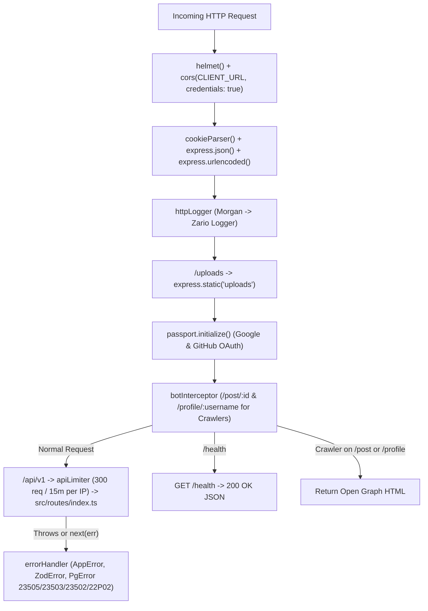

# Project Tour

> **Purpose:** Give new developers a concrete mental map of how code executes from `src/server.ts` startup through an HTTP request, database transaction, and background worker.
> **Audience:** Internal backend developers onboarding to the codebase.
> **Prerequisites:** Have the stack running via [5-Minute Quickstart](quickstart.md).

## Overview

Writespace is organized as a modular monolith under `src/`. A single Node.js process (`src/server.ts`) boots the infrastructure connections (PostgreSQL and Redis), mounts the Express 5 application (`src/app.ts`) and the Socket.IO real-time notification server (`src/modules/notification/realtime/notification-socket.server.ts`) on a shared Node HTTP server, and starts the BullMQ workers and outbox polling loops.

## 1. Server bootstrap (`src/server.ts`)

When you run `npm run dev` (or `npm start`), `src/server.ts` executes `startServer()` in a strict dependency order:

1. **Database verification:** Runs `await pool.query("SELECT 1")` against the `pg` connection pool (`src/db/index.ts`).
2. **Redis connection:** Calls `await connectRedis()` (`src/config/redis.ts`), which is used by Redis rate limiters, OAuth state storage, registration OTP cache, and legacy token cleanup.
3. **Core BullMQ queues:** Dynamically imports `emailQueue` (`email-queue`) and `mediaQueue` (`media-cleanup`) from `src/shared/queues/`.
4. **Express & Socket.IO binding:** Dynamically imports `src/app.ts`, wraps it in `node:http` `createServer(app)`, and attaches `initializeNotificationSocketServer(server)`.
5. **Core background workers:** Starts `emailWorker` (`src/shared/queues/email.worker.ts`) and `mediaWorker` (`src/shared/queues/media.worker.ts`).
6. **Durable notification pipeline (when `OUTBOX_PROCESSING_ENABLED=true`):**
   - Initializes `notificationEventsQueue` and `notificationDeliveryEventsQueue`.
   - Starts `notificationEventsWorker` and `notificationDeliveryEventsWorker` and awaits `waitUntilReady()` on both.
   - Starts `notificationReconciliationWorker` and `outboxDispatcherWorker` (using `workers.unshift(...)` so they stop _first_ during graceful shutdown before queue consumers drain).
7. **HTTP listen:** Binds to `0.0.0.0:${env.PORT}` (port `8000`).

## 2. The Express middleware pipeline (`src/app.ts`)

Every incoming HTTP request passes through `src/app.ts` in the exact registration order shown below:

**Diagram: Express Request Pipeline (`src/app.ts`)**

## 3. Tracing a feature end-to-end: Adding a reaction

To see how the layers collaborate, trace what happens when a logged-in client sends `POST /api/v1/interactions/posts/:postId/reaction` with `{ "reactionType": "celebrate" }`:

1. **Route & Middleware (`src/modules/interactions/interactions.routes.ts`):**
   - `authenticate` (`src/shared/middlewares/auth.middleware.ts`) verifies the Bearer JWT (HS256) and calls `sessionService.isSessionValidForAccess(decoded.sid, decoded.id)` to confirm the session in `auth_sessions` is unrevoked, unexpired, and belongs to an active user.
   - `validate(setReactionSchema)` (`src/shared/middlewares/validate.middleware.ts`) validates `req.body.reactionType` against the 7 allowed `reactionType`s (`like`, `love`, `laugh`, `celebrate`, `support`, `sad`, `angry`).

2. **Controller & Facade (`interactions.controllers.ts` → `interactions.service.ts`):** `interactionsController.setPostReaction` delegates to `interactionsService.setPostReaction`, which calls `reactionService.setContentItemReaction` (`src/modules/interactions/services/reaction.service.ts`).

3. **Transactional Write + Outbox (`reaction.service.ts` & `reaction.repository.ts`):**
   - Inside `db.transaction(async (transaction) => ...)`, `reactionRepository.setContentItemReaction` locks the parent `content_items` row (`FOR UPDATE`), verifies the item is `"published"` and its subtype row exists in `posts` or `articles`, inserts or updates the row in `content_reactions`, and increments `content_items.reaction_count` if the reaction is new.
   - Before the transaction commits, `reactionService` calls `eventPublisherService.recordInTransaction(transaction, ...)` (`src/modules/notification/services/event-publisher.service.ts`), validating the payload against `eventRegistry["reaction.added"]` and inserting a `PENDING` row into `outbox_events`.
   - After the transaction commits, `reactionService` writes a best-effort historical record to `interaction_events` (`interactionEventPublisher.publish`) and returns `new ApiResponse(res, 200, ...)` to the client.

4. **Outbox Dispatch (`outbox-dispatcher.worker.ts` → `outbox-dispatcher.service.ts`):** Every `OUTBOX_DISPATCHER_POLL_INTERVAL_MS` (`1000`ms), `outboxDispatcherService.dispatchBatch` claims due `PENDING` rows in `outbox_events` with a `60000`ms lease, enqueues `{ eventId }` into BullMQ's `notification-events-queue`, and marks the outbox row `PUBLISHED`.

5. **Notification Processing & Grouping (`notification-events.worker.ts` → `notification-processor.service.ts`):** `notificationProcessorService.process(eventId)` reserves `(consumer_name, event_id)` in `processed_events`, verifies the reaction still exists in `content_reactions`, checks the recipient's `notification_preferences`, and — because the target is a Post — groups the reaction into a 5-minute bucket in `notification_groups` via `notificationGroupRepository.addPostReactionToGroup` (`src/modules/notification/domain/notification-grouping.policy.ts`). In the same transaction, it creates a `queued` row in `notification_deliveries` (`channel: "realtime"`) and a `notification.delivery.requested` event in `outbox_events`.

6. **Realtime Socket.IO Delivery (`notification-delivery-events.worker.ts` → `notification-realtime.handler.ts`):** Once the dispatcher pushes the delivery event to `notification-delivery-events-queue`, `notificationDeliveryService.process` claims the delivery lease, runs a lease-renewal heartbeat every `leaseDurationMs / 3`, and invokes `notificationRealtimeHandler.deliver`. The handler emits `notification.created` (or `notification.updated` for grouped reactions) and `notification.unread-count.updated` to the recipient's private Socket.IO room `user:<recipientUserId>`.

## Where to go next

| If you want to...                                                                          | Read this next                                                                                                      |
| :----------------------------------------------------------------------------------------- | :------------------------------------------------------------------------------------------------------------------ |
| Understand the core domain entities (`content_items`, `ContentDocument`, sessions, outbox) | [System Mental Model](../concepts/overview.md) & [Domain Model](../concepts/domain-model.md)                        |
| Inspect the C4 architecture diagrams and component boundaries                              | [Architecture Overview](../architecture/overview.md) & [Component Breakdown](../architecture/components.md)         |
| Explore the folder layout and module layering rules                                        | [Repository Structure](../codebase/repository-structure.md) & [Engineering Conventions](../codebase/conventions.md) |
| Look up REST endpoints or Socket.IO event payloads                                         | [API Overview](../api/overview.md) & [Realtime Socket.IO Contract](../api/realtime-events.md)                       |

## Key decisions & rationale

- **Path aliases for clean cross-module imports:** `tsconfig.json` defines four path aliases (`@modules/*`, `@config/*`, `@shared/*`, `@db/*`) resolved at dev time via `tsconfig-paths/register` (`nodemon.json`) and rewritten at build time via `tsc-alias` (`package.json`).
- **Shared HTTP server for Express and Socket.IO:** Attaching Socket.IO directly to the `node:http` server in `src/server.ts` allows both REST (`/api/v1`) and WebSocket traffic to share port `8000` behind a single reverse proxy.

## Gotchas & edge cases

- **`botInterceptor` route matching (`src/shared/middlewares/bot-interceptor.middleware.ts`):** The crawler interceptor matches `GET /post/:id` and `GET /profile/:username` (excluding `/profile/me`) when the `User-Agent` header matches known social bots (Twitterbot, LinkedInBot, Slackbot, WhatsApp, etc.). Normal browser requests pass straight through to `next()`.

- **Socket.IO owns HTTP server shutdown:** During `gracefulShutdown` in `src/server.ts`, calling `activeSocketServer.close()` automatically disconnects WebSocket clients and closes the underlying Node HTTP server — never call `server.close()` a second time when `notificationSocketServer` is active.

## Related

- [5-Minute Quickstart](quickstart.md)
- [System Mental Model](../concepts/overview.md)
- [Entry Points & Server Lifecycle](../codebase/entry-points.md)
- [Request & Event Data Flow](../architecture/data-flow.md)

---

_Last verified against: v1.0.0 (12bc4d7, documentation branch, 2026-11-17)_
