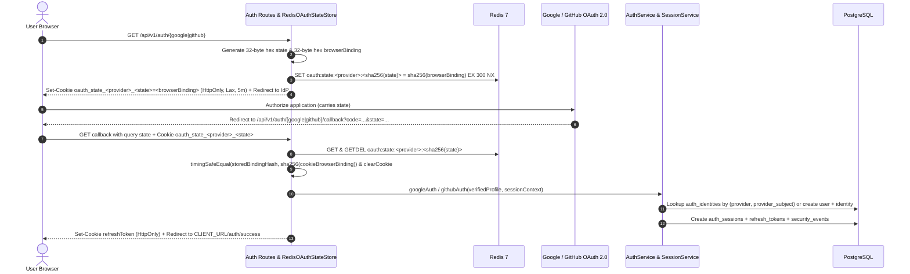

# Authentication & Sessions

> **Purpose:** Document the internal design and implementation of `src/modules/auth/` and `src/modules/sessions/`, including registration OTPs, OAuth2 state protection, session lifecycle, and refresh token reuse detection.
> **Audience:** Internal backend developers maintaining authentication or session security.
> **Prerequisites:** Read [System Mental Model](../concepts/overview.md) and [ADR-0007: Server-Managed Sessions with Hashed Refresh Token Rotation](../decisions/ADR-0007-session-and-refresh-token-rotation.md).

## Overview

Authentication and session management span two closely collaborating modules:

- **`src/modules/auth/`**: Owns user registration (`initiateRegistration`, `verifyRegistration`), email/password login (`login`), Google and GitHub OAuth 2.0 (`configurePassport`, `RedisOAuthStateStore`, `handleSocialAuth`), password recovery (`forgotPassword`, `resetPassword`), and token refresh/logout (`refreshToken`, `logout`).
- **`src/modules/sessions/`**: Owns server-managed sessions (`auth_sessions`), opaque refresh token hashing and rotation (`refresh_tokens`), active session inspection/revocation (`/api/v1/sessions/*`), and transactional security audit logging (`security_events` + `auth.security_alert` outbox events).

## 1. Two-step registration with HMAC-SHA256 OTP (`auth.service.ts`)

Registration never writes an unverified user row to PostgreSQL:

1. **`initiateRegistration(data)` (`POST /api/v1/auth/register`):**
   - Queries `users` to verify that neither `email` nor `username` is already taken (`409 Conflict` if found).
   - Generates a 6-digit numeric OTP via `generateOTP(6)` (`crypto.randomInt(0, 10)` in `src/modules/auth/auth.utils.ts`) and a random `challengeId` (`randomUUID()`).
   - Hashes the user's plaintext password with `bcrypt.hash(password, 12)` (`SALT_ROUNDS = 12`). Plaintext passwords are **never** stored in Redis.
   - Computes a challenge-bound HMAC-SHA256 digest of the OTP using the 64-hex-character `env.AUTH_CHALLENGE_SECRET`:
     ```typescript
     createHmac("sha256", Buffer.from(env.AUTH_CHALLENGE_SECRET, "hex"))
       .update(`${challengeId}:${email}:${otp}`)
       .digest("hex");
     ```
   - Stores `{ fullname, username, email, passwordHash, challengeId, otpHash }` as JSON in Redis at `auth:register:${data.email}` with a 10-minute TTL (`EX: 600`) and enqueues the OTP email via `notificationService.sendOtpEmail(data.email, otp)` (`removeOnFail: true`).
2. **`verifyRegistration(email, otp, context)` (`POST /api/v1/auth/verify-email`):**
   - Reads `auth:register:${email}` from Redis and recomputes the HMAC-SHA256 digest using the stored `challengeId`.
   - Compares the expected and submitted digests in constant time using `crypto.timingSafeEqual`. An invalid OTP throws `400 Bad Request` (`"Invalid OTP"`) **without** deleting the Redis key, allowing the user to retry within the rate-limit and 10-minute TTL window.
   - Once the OTP matches, consumes the Redis key atomically with `await redis.getDel(registrationKey)` (`400 Bad Request` if a concurrent request already consumed it).
   - Opens `db.transaction` to insert into `users`, insert a `"password"` row into `auth_identities`, and record `auth.registration_completed` in `security_events`.
   - Creates a durable session via `sessionService.createSession`, sends a best-effort welcome email (`notificationService.sendWelcomeEmail`), and returns `{ user, accessToken }` (plus `refreshToken` in cookie or body).

## 2. OAuth 2.0 with `RedisOAuthStateStore` (`oauth-state.store.ts` & `auth.utils.ts`)

Google (`passport-google-oauth20`) and GitHub (`passport-github2`) strategies in `src/modules/auth/auth.utils.ts` run with `session: false` and delegate state protection to `RedisOAuthStateStore` (`src/modules/auth/oauth-state.store.ts`).

**Diagram: OAuth 2.0 Redis State & Browser-Binding Handshake**



## OAuth account linking & identity rules (`auth.service.ts`)

- **Verified email requirement:** `getVerifiedOAuthEmail` (`src/modules/auth/auth.controller.ts`) inspects `driverUser.emails` and accepts only entries with `verified === true`, preferring `primary === true`. If no verified email is returned by the provider, the controller redirects to `${env.CLIENT_URL}/auth/failed?reason=verified_email_required`.

- **Authoritative `provider_subject` lookup:** `handleSocialAuth` queries `auth_identities` by `(provider, providerSubject)`. Email addresses are never used to match an existing OAuth identity.

- **No silent email linking:** If no `auth_identities` row matches `(provider, providerSubject)`, `handleSocialAuth` checks whether any `users` row already owns `email`. If an account with that email exists, it throws `409 Conflict` (`"An account with this email already exists. Sign in using your existing authentication method."`) rather than silently linking the OAuth provider to the existing password/OAuth account.

- **Web-only OAuth callback in v1:** `googleCallback` and `githubCallback` reject requests with `x-client-type: native` (`400 Bad Request`: `"Native OAuth authentication is not supported by this callback yet."`).

## 3. Password reset & password change session revocation

| Workflow        | Endpoint                                                            | Challenge / Verification                                                                                                                                                                                                                                                                                                                    | Session Revocation Behavior                                                                                                                                                    | Security Event Emitted                                                       |
| --------------- | ------------------------------------------------------------------- | ------------------------------------------------------------------------------------------------------------------------------------------------------------------------------------------------------------------------------------------------------------------------------------------------------------------------------------------- | ------------------------------------------------------------------------------------------------------------------------------------------------------------------------------ | ---------------------------------------------------------------------------- |
| Forgot Password | `POST /api/v1/auth/forgot-password`                                 | Generates 32-byte hex `resetToken` (`randomBytes(32).toString("hex")`), stores `sha256(resetToken)` in `auth_challenges` (`purpose: "password_reset"`, TTL 1 hour), emails `${CLIENT_URL}/auth/reset-password?token=${resetToken}` (`removeOnFail: true`). Always returns `200 OK` (`"If that email exists, a reset link has been sent."`). | None until reset is completed.                                                                                                                                                 | None.                                                                        |
| Reset Password  | `POST /api/v1/auth/reset-password`                                  | Locks unconsumed, unrevoked, unexpired `auth_challenges` row matching `sha256(token)` with `FOR UPDATE`, marks `consumed_at = now`, updates `users.password_hash` and `auth_identities.password_hash`.                                                                                                                                      | Revokes all active sessions for the user (`sessionService.revokeAllUserSessionsInTransaction(tx, account.id, now, "password_reset")`) and clears legacy Redis keys.            | `password.reset` (triggers mandatory `auth.security_alert` inbox + email).   |
| Change Password | `PUT /api/v1/users/me/password` (or `/api/v1/auth/update-password`) | Verifies `currentPassword` with `bcrypt.compare`, locks `users` row `FOR UPDATE` (checking `lockedUser.passwordHash === user.passwordHash`), updates `users` and `auth_identities`.                                                                                                                                                         | Revokes all other sessions while preserving `currentSessionId` (`sessionService.revokeOtherUserSessionsInTransaction(tx, userId, currentSessionId, now, "password_changed")`). | `password.changed` (triggers mandatory `auth.security_alert` inbox + email). |

## 4. Session & refresh token lifecycle (`src/modules/sessions/`)

`SessionService` (`src/modules/sessions/session.service.ts`), `SessionRepository` (`session.repository.ts`), and `RefreshTokenRepository` (`refresh-token.repository.ts`) enforce these rules:

- **Session timeouts:** `idleExpiresAt` is set to `Math.min(now + IDLE_TIMEOUT_MS, absoluteExpiresAt)`. On every refresh token rotation (`RefreshTokenRepository.rotate`), `idleExpiresAt` slides forward by `SESSION_IDLE_TIMEOUT_SECONDS` (604800s / 7 days) but can never exceed `absoluteExpiresAt` (2592000s / 30 days from initial login).

- **Public session projection (`SessionSummary`):** `GET /api/v1/sessions` and `GET /api/v1/sessions/:sessionId` return only `{ id, clientType, deviceLabel, createdAt, lastSeenAt, idleExpiresAt, absoluteExpiresAt, isCurrent }`. Internal fields (`firstIp`, `lastIp`, `userAgentSummary`, `authMethods`, `assuranceLevel`) are stripped by `toSessionSummary`.

- **Current-session cookie cleanup:** If a web client calls `DELETE /api/v1/sessions/:sessionId` where `sessionId === currentSessionId`, or calls `POST /api/v1/sessions/revoke-all`, `SessionController` automatically clears the browser's `refreshToken` cookie (`src/modules/sessions/session.controller.ts`).

## Key decisions & rationale

- **Why store separate cookies per OAuth state (`oauth_state_<provider>_<state>`)?** Naming the browser-binding cookie with the state suffix in `RedisOAuthStateStore.cookieName` (`src/modules/auth/oauth-state.store.ts`) lets a user open multiple OAuth login tabs concurrently without a newer tab overwriting the previous tab's browser-binding cookie.

- **Why strip `googleAuth` and `githubAuth` from `PublicUser`?** Both `toPublicUser` in `src/modules/auth/auth.service.ts` and `UserService.toPublicUser` in `src/modules/users/user.service.ts` delete `passwordHash`, `loginAttempts`, `lockUntil`, `googleAuth`, and `githubAuth` before returning user objects so internal authentication flags never leak in API responses.

## Gotchas & edge cases

- **Misleading comment in `resetPasswordSchema` (`src/modules/auth/dtos/password-reset.dto.ts`):** A comment in `password-reset.dto.ts` says `"Reset tokens are generated using generateOTP(32), so they must contain exactly 32 numeric characters"`, but the actual Zod regex right below it is `/^[a-f0-9]{64}$/i`, which matches the 32-byte hex token (`randomBytes(32).toString("hex")`) generated in `AuthService.forgotPassword`. Trust the regex and `auth.service.ts`, not the stale comment.

- **`loginAttempts` and `lockUntil` columns on `users` are not currently incremented on failed logins:** Although `users` defines `login_attempts` and `lock_until` (`src/db/schema/users.ts`), brute-force login protection in v1 is enforced via the Redis rate limiters `loginLimiter` (10 failed attempts / 15m per IP) and `loginEmailLimiter` (5 failed attempts / 15m per email) in `src/shared/middlewares/rate-limit.middleware.ts`.

## Related

- [ADR-0007: Server-Managed Sessions with Hashed Refresh Token Rotation](../decisions/ADR-0007-session-and-refresh-token-rotation.md)
- [Frontend Authentication & Token Flow](../api/authentication.md)
- [Auth & Session Endpoints](../api/endpoints/auth.md)
- [Secrets & Credential Hashing](../security/secrets-management.md)

_Last verified against: v1.0.0 (b97c4fa, documentation branch, 2026-11-17)_
