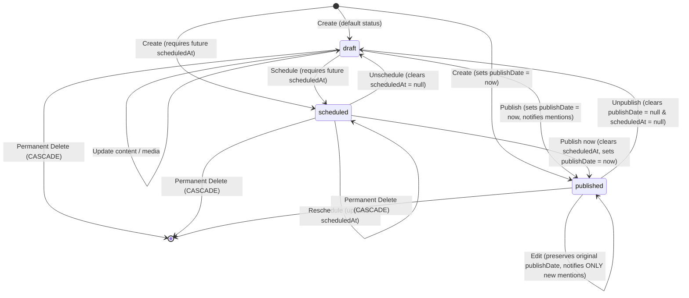

# Posts & Articles (Shared Content)

> **Purpose:** Explain how `src/modules/posts/` and `src/modules/articles/` implement short-form Posts and long-form Articles on top of the shared `content_items` and `ContentDocument` contracts.
> **Audience:** Internal backend developers working on publishing, feeds, slugs, or content lifecycle.
> **Prerequisites:** Read [ADR-0001: Shared Content Identity (`content_items`)](../decisions/ADR-0001-shared-content-identity.md) and [ADR-0002: Structured JSONB `ContentDocument` & Externalized `post_media`](../decisions/ADR-0002-structured-content-document.md).

## Overview

Writespace supports two publishable content formats—**Posts** (`src/modules/posts/`) and **Articles** (`src/modules/articles/`)—built on a shared parent table (`content_items` in `src/db/schema/content-items.ts`) and a shared block-editor JSONB contract (`ContentDocument` in `src/db/schema/content-document.ts`). Both modules follow the exact same internal architecture: a controller (`*.controller.ts`), a route file (`*.routes.ts`), a top-level service facade (`*.service.ts`), four focused sub-services (`services/*-{command,query,media,preview}.service.ts`), and a database-free domain folder (`domain/*-{content,lifecycle,slug}.ts`).

### Posts vs. Articles comparison

| Dimension                   | Short-Form Posts (`src/modules/posts/`)                                                                        | Long-Form Articles (`src/modules/articles/`)                                                                                                                                            |
| :-------------------------- | :------------------------------------------------------------------------------------------------------------- | :-------------------------------------------------------------------------------------------------------------------------------------------------------------------------------------- |
| **Database Tables**         | `content_items` (`content_type = 'post'`) + `posts` + `post_media`                                             | `content_items` (`content_type = 'article'`) + `articles`                                                                                                                               |
| **Public URL / Lookup**     | UUID only: `/posts/:id` (`GET /api/v1/posts/:id`)                                                              | Unique slug (`GET /api/v1/articles/:slug`) or UUID (`GET /api/v1/articles/id/:id`)                                                                                                      |
| **Title & Subtitle**        | None (preview title is generated as `"<Author> on Writespace"` or `"Post by <Author>"`)                        | Required `title` (5–200 chars) and optional `subtitle` (max 300 chars)                                                                                                                  |
| **`ContentDocument` Limit** | Max **6,000** visible characters (`MAX_POST_CHARACTERS = 6000`)                                                | No character limit; must contain non-empty readable text to schedule or publish                                                                                                         |
| **Empty Drafts Allowed?**   | Yes (`contentDocument` defaults to `{ version: 1, blocks: [] }`, even when publishing a Post with only images) | Empty drafts allowed (`status = 'draft'`), but `assertPublishableContent` rejects empty `scheduled` or `published` Articles                                                             |
| **Link URL Protocol Check** | `z.string().url()` (`src/modules/posts/dtos/create-post.dto.ts`)                                               | `z.string().url()` + explicit `http:` / `https:` protocol refinement (`src/modules/articles/dtos/create-article.dto.ts`)                                                                |
| **Excerpt & Read Time**     | None                                                                                                           | `excerpt` (manual max 300 chars, or auto-generated up to 200 chars from document text) + `readTime` (`Math.max(1, Math.ceil(words / 200))`)                                             |
| **Tags**                    | Up to 5 non-empty strings (`tags: text[]`)                                                                     | Up to 5 strings, each 1–50 chars (`tags: text[]`)                                                                                                                                       |
| **Media Attachments**       | Up to **5** ordered images in `post_media` (`upload.fields([{ name: "media", maxCount: 5 }])`)                 | Up to **1** optional cover image on `articles` (`upload.fields([{ name: "coverImage", maxCount: 1 }])`) with `altText` and `credit`                                                     |
| **Share Platforms**         | `x`/`twitter`, `facebook`, `linkedin`, plus fallback canonical URL (`posts.service.ts`)                        | 11 validated platforms: `linkedin`, `x` (`twitter` normalized to `x`), `whatsapp`, `facebook`, `reddit`, `telegram`, `bluesky`, `pinterest`, `email`, `generic` (`articles.service.ts`) |
| **Reaction Grouping**       | `reaction.added` events are grouped into 5-minute UTC buckets in `notification_groups`                         | `reaction.added` events create individual `notifications` rows                                                                                                                          |

### Content lifecycle state machine

Both `src/modules/posts/domain/post-lifecycle.ts` and `src/modules/articles/domain/article-lifecycle.ts` enforce the exact same transition matrix (`VALID_TRANSITIONS`):

**Diagram: Content Lifecycle State Machine**



### Lifecycle & timestamp rules (`resolveLifecycleState`)

- **Invalid transition (`published → scheduled`):** Attempting to move an already published Post or Article to `scheduled` is rejected by `assertValidTransition` with `400 Bad Request` (`"Invalid post/Article status transition: published -> scheduled"`). To reschedule a published item, it must return to `draft` first.

- **`scheduled` state invariants:** When `status === "scheduled"`, `scheduledAt` must be a valid ISO-8601 datetime with offset that is strictly in the future (`scheduledAt > now`), and `publishDate` is set to `null`. When `status !== "scheduled"`, supplying a non-null `scheduledAt` is rejected with `400 Bad Request`.

- **`published` timestamp preservation:** When an already published item is edited while remaining published, `resolveLifecycleState` preserves `currentState.publishDate` instead of overwriting it with `now`. Moving a published item back to `draft` clears `publishDate = null`.

### Structured `ContentDocument` processing

Both `posts.content_document` and `articles.content_document` persist a JSONB object matching `ContentDocument` (`src/db/schema/content-document.ts`):

```json
{
  "version": 1,
  "blocks": [
    {
      "type": "paragraph",
      "children": [
        { "type": "text", "text": "Read more at " },
        {
          "type": "link",
          "text": "PostgreSQL Docs",
          "url": "[https://www.postgresql.org/docs/](https://www.postgresql.org/docs/)"
        },
        { "type": "text", "text": " with " },
        { "type": "mention", "userId": "6f9619ff-8b86-d011-b42d-00c04fc964ff" }
      ]
    },
    {
      "type": "code",
      "language": "sql",
      "code": "SELECT 1;"
    }
  ]
}
```

### Character counting, text extraction & @mention synchronization

1. **Character counting (`countContentDocumentCharacters` / `countArticleCharacters`):** Sums `block.code.length` for code blocks and `node.text.length` for text and link nodes inside paragraph blocks. Neither `link.url` nor `mention.userId` counts toward the character total.

2. **Plain-text extraction (`extractContentText` / `extractArticleText`):** Concatenates text nodes, `link.text` labels, and `code.code` strings while omitting mention nodes so raw UUIDs never appear in generated Article excerpts or social preview descriptions.

3. **Mention validation & diffing (`post-command.service.ts`, `article-command.service.ts`):**
   - `collectMentionedUserIds` / `collectArticleMentionedUserIds` deduplicates all `mention.userId` UUIDs in document order.
   - Inside the create/update transaction, the command service runs `SELECT id FROM users WHERE id IN (...)` and aborts with `400 Bad Request` (`"One or more mentioned users do not exist"`) if any UUID is missing.
   - On update, if `contentDocumentChanged` is `true`, the service deletes existing `content_mentions` rows for `contentItemId` and inserts the updated set.
   - **Notification eligibility:** If the item is transitioning from `draft`/`scheduled` to `published`, all current mentions emit `mention.created` outbox events. If the item was already published before the edit, only newly added mention UUIDs (not present in the previous `contentDocument`) emit `mention.created` outbox events.

### Optimistic concurrency & slug immutability

**Optimistic concurrency (`content_items.version`):** During `updatePost` and `updateArticle`, if any field changed (`hasChanges === true`), the transaction first executes:

```sql
UPDATE content_items
SET status = $1, scheduled_at = $2, publish_date = $3, version = version + 1, updated_at = now()
WHERE id = $4 AND version = $5
RETURNING id;
```

If no row is returned because a concurrent update incremented `version`, the transaction rolls back and returns `409 Conflict` (`"Post/Article was modified by another request. Please refresh and try again."`).

- **Article slug generation & immutability (`article-slug.ts` & `article-command.service.ts`):**
  - If the client omits `slug` during `POST /api/v1/articles/create`, `generateArticleSlugCandidate(title)` slugifies the title (`slugify(title, { lower: true, strict: true, trim: true }) || "article"`) and appends `-${randomUUID()}`.

  - Updating an Article's `title` does not automatically regenerate `slug`.

  - Explicitly changing `slug` in `PUT /api/v1/articles/:id` is permitted while `currentStatus` is `draft` or `scheduled`, but throws `400 Bad Request` (`"Published Article slugs cannot be changed until URL redirects are supported"`) once `currentStatus === "published"`.

### Key decisions & rationale

- **Why fetch feed `post_media` in a single batch query (`getMediaByPostIds`)?** In `PostQueryService.getPosts` (`src/modules/posts/services/post-query.service.ts`), after fetching the page of posts, the service collects all `postIds` on the page and runs one `SELECT * FROM post_media WHERE post_id IN (...) ORDER BY post_id ASC, position ASC` query, grouping attachments in memory to avoid N+1 queries.

- **Why check `followedAuthorIds` per feed page?** Both `PostQueryService.getPosts` and `ArticleQueryService.getArticles` extract the unique `authorId` values present on the current page and query `SELECT following_id FROM follows WHERE follower_id = :requesterId AND following_id IN (:pageAuthorIds)` rather than loading the user's entire following list.

### Gotchas & edge cases

- **`isLikedByMe` checks only `reaction_type = 'like'`:** In `PostQueryService` and `ArticleQueryService`, the boolean `isLikedByMe` field uses `EXISTS (SELECT 1 FROM content_reactions WHERE content_item_id = content_items.id AND user_id = :requesterId AND reaction_type = 'like')`. If a user reacted with `'love'`, `'celebrate'`, or another non-`'like'` reaction via `/api/v1/interactions/posts/:postId/reaction`, `isLikedByMe` is `false`.

- **Single-article lookup vs. feed `isFollowingByMe` placement:** In `ArticleQueryService.getArticleByCondition` (single Article lookup), `isFollowingByMe` is returned at the top level of the response object (`{ ...article, coverImage, isLikedByMe, author, isFollowingByMe }`), whereas in `ArticleQueryService.getArticles` and `PostQueryService.getPosts` (paginated feeds), `isFollowingByMe` is nested inside `author` (`author: { id, username, fullname, profileImageUrl, isFollowingByMe }`), and in `PostQueryService.getPost` (single Post lookup), `isFollowingByMe` is not queried.

## Related

- [ADR-0001: Shared Content Identity (`content_items`)](../decisions/ADR-0001-shared-content-identity.md)
- [ADR-0002: Structured JSONB `ContentDocument` & Externalized `post_media`](../decisions/ADR-0002-structured-content-document.md)
- [Media & OG Image Handling](media.md)
- [Post Endpoints](../api/endpoints/posts.md)
- [Article Endpoints](../api/endpoints/articles.md)

_Last verified against: v1.0.0 (b97c4fa, documentation branch, 2026-11-17)_
