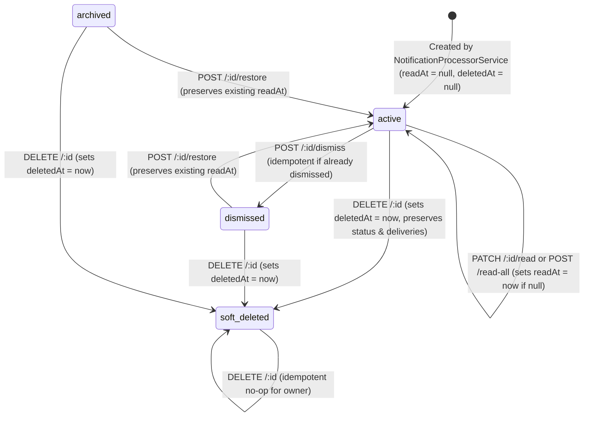
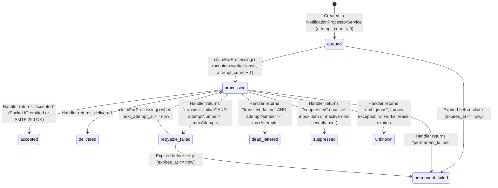

# Notifications, Outbox & Realtime

> **Purpose:** Document the internal architecture of `src/modules/notification/`, tracing how domain events become grouped inbox items, how user preferences are evaluated, and how `realtime` and `email` deliveries execute under leases.
> **Audience:** Internal backend developers maintaining notifications, workers, or Socket.IO real-time events.
> **Prerequisites:** Read [ADR-0003](../decisions/ADR-0003-transactional-outbox-and-idempotency.md), [ADR-0004](../decisions/ADR-0004-decoupled-notification-architecture.md), and [ADR-0005](../decisions/ADR-0005-dual-lease-delivery-reconciliation.md).

## Overview

`src/modules/notification/` is the largest module in Writespace. It owns five subsystems:

1. **Transactional Outbox Publisher & Dispatcher** (`services/event-publisher.service.ts`, `services/outbox-dispatcher.service.ts`, `workers/outbox-dispatcher.worker.ts`)
2. **Domain Event Registry, Policy Catalog & Processor** (`domain/*`, `events/*`, `services/notification-processor.service.ts`, `workers/notification-events.worker.ts`)
3. **In-App Inbox & Preference APIs** (`notification.controller.ts`, `notification-preference.controller.ts`, `services/notification-inbox.service.ts`, `services/notification-preference.service.ts`)
4. **Leased Channel Delivery & Reconciliation** (`services/notification-delivery.service.ts`, `services/notification-reconciliation.service.ts`, `handlers/notification-{realtime,email}.handler.ts`, `workers/notification-{delivery-events,reconciliation}.worker.ts`)
5. **Authenticated Socket.IO Server & HTML Email Templates** (`realtime/notification-socket.server.ts`, `templates/*.ts`, and the legacy auth/account email facade `notification.service.ts`)

### 1. Domain event registry & policy catalog (`events/` & `domain/`)

Every event published through `eventPublisherService.recordInTransaction` is validated against `eventRegistry` (`src/modules/notification/events/event.registry.ts`, all currently at `version: 1`) and evaluated against `notificationPolicyRegistry` (`src/modules/notification/domain/notification-policy.registry.ts`, policy version `"notification-policy-v2"`):

| Event Name (`DomainEventName`) | Producer String                        | Policy Category & Priority | Classification                          | Inbox Behavior in `NotificationProcessorService`                                                                                                                                                             | Channels Triggered                                                       |
| :----------------------------- | :------------------------------------- | :------------------------- | :-------------------------------------- | :----------------------------------------------------------------------------------------------------------------------------------------------------------------------------------------------------------- | :----------------------------------------------------------------------- |
| `reaction.added`               | `interactions.reactions`               | `social` / `normal`        | `optional` (editable)                   | Verifies reaction still exists & content is `published`. Suppresses self-reactions. Groups `post` reactions into 5m UTC windows; keeps `article` & `comment` reactions individual.                           | `in_app` (`realtime` Socket.IO)                                          |
| `reaction.changed`             | `interactions.reactions`               | None                       | None                                    | Validated, then returns `null` (`outcome: "no_delivery_required"`).                                                                                                                                          | None                                                                     |
| `reaction.removed`             | `interactions.reactions`               | None                       | None                                    | Validated, then returns `null` (`outcome: "no_delivery_required"`).                                                                                                                                          | None                                                                     |
| `follow.created`               | `interactions.follow`                  | `social` / `normal`        | `optional` (editable)                   | Locks both users in `ASC` ID order and verifies `follows` row still exists. Creates `FOLLOW` notification.                                                                                                   | `in_app` (`realtime` Socket.IO)                                          |
| `follow.removed`               | `interactions.follow`                  | None                       | None                                    | Validated, then returns `null` (`outcome: "no_delivery_required"`).                                                                                                                                          | None                                                                     |
| `save.created`                 | `interactions`                         | None                       | None                                    | Private action; returns `null` (`outcome: "no_delivery_required"`).                                                                                                                                          | None                                                                     |
| `save.removed`                 | `interactions`                         | None                       | None                                    | Private action; returns `null` (`outcome: "no_delivery_required"`).                                                                                                                                          | None                                                                     |
| `share.created`                | `interactions`                         | None                       | None                                    | Analytics-only; returns `null` (`outcome: "no_delivery_required"`).                                                                                                                                          | None                                                                     |
| `comment.created`              | `interactions.comments`                | `social` / `normal`        | `optional` (editable)                   | Verifies comment still exists, is top-level (`parentCommentId === null`), content is `published`, and `commentAuthorId !== recipientUserId`. Creates `COMMENT` notification.                                 | `in_app` (`realtime` Socket.IO)                                          |
| `comment.replied`              | `interactions.comments`                | `social` / `normal`        | `optional` (editable)                   | Verifies reply and parent comment belong to the same `published` content item and `replyAuthorId !== parentAuthorId`. Notifies the immediate parent comment's author (`COMMENT`).                            | `in_app` (`realtime` Socket.IO)                                          |
| `mention.created`              | `posts.commands` / `articles.commands` | `social` / `normal`        | `optional` (editable)                   | Verifies `content_mentions` row still exists, content is `published`, and author did not mention themselves. Creates `MENTION` notification.                                                                 | `in_app` (`realtime` Socket.IO)                                          |
| `auth.security_alert`          | `authentication`                       | `security` / `high`        | `mandatory_security` (**non-editable**) | Maps `securityEventType` (`auth.login`, `auth.oauth_login`, `password.reset`, `password.changed`, `account.suspended`, `refresh_token.reuse_detected`) to allowlisted copy in `SECURITY_ALERT_PRESENTATION`. | `in_app` (`realtime` Socket.IO) **+ `email`** (`auth-security-alert-v1`) |

### 2. Inbox lifecycle state machine (`notifications`)

In-app notifications (`src/db/schema/notifications.ts`) track visibility (`status`), read state (`read_at`), and soft deletion (`deleted_at`) independently. All lifecycle mutations in `NotificationRepository` (`src/modules/notification/repositories/notification.repository.ts`) lock the row with `FOR UPDATE` scoped to `recipient_user_id`:

**Diagram: Notification Inbox Lifecycle State Machine**

- **Dismissal rule:** Only active notifications can transition to `dismissed` via `POST /api/v1/notifications/:notificationId/dismiss`. Attempting to dismiss an archived notification returns `409 Conflict` (`"Only active notifications can be dismissed."`).

- **Bell unread count:** `countUnreadForRecipient` counts rows where `status = 'active'` AND `read_at IS NULL` AND `deleted_at IS NULL` using the partial index `notifications_active_unread_idx`. Even when a user queries `GET /api/v1/notifications?view=dismissed`, the top-level `unreadCount` field in the response always reflects the active inbox unread count.

### 3. Channel delivery state machine (`notification_deliveries`)

Every logical delivery request in `notification_deliveries` (`src/db/schema/notification-deliveries.ts`) transitions through the state machine managed by `NotificationDeliveryService` (`src/modules/notification/services/notification-delivery.service.ts`), `NotificationDeliveryRepository` (`repositories/notification-delivery.repository.ts`), and `NotificationReconciliationService` (`services/notification-reconciliation.service.ts`):

**Diagram:** Notification Channel Delivery State Machine

### 4. Email templates & dual email pipelines (`templates/` & `notification.service.ts`)

All 7 HTML/text email templates in `src/modules/notification/templates/` share `baseEmailLayout` (`templates/layout.ts`), which applies Writespace branding (`midnightNavy: "#191638"`, `coral: "#FF765E"`, `lavender: "#897AF0"`, `warmIvory: "#F8F6F1"`), escapes all dynamic strings with `escapeHtml`, and restricts button URLs via `safeEmailUrl` (`http:`, `https:`, `#`, or single-slash `/` paths only):

#### 1. Legacy Auth/Account Email Facade (`src/modules/notification/notification.service.ts` → `email-queue`)

- `sendOtpEmail` (`templates/otp-verify.ts`, `removeOnFail: true`, skipped by `emailWorker` if job age > `10 * 60 * 1000 ms`)
- `sendPasswordResetEmail` (`templates/password-reset.ts`, `removeOnFail: true`)
- `sendWelcomeEmail` (`templates/welcome.ts`)
- `sendLoginAlert` (`templates/login-alert.ts`)
- `sendPasswordUpdateEmail` (`templates/password-update.ts`)
- `sendProfileUpdateEmail` (`templates/profile-update.ts`)

#### 2. Durable Notification Email Handler (`handlers/notification-email.handler.ts` → `notification-delivery-events-queue`)

- Renders `securityAlertEmailTemplate` (`templates/security-alert.ts`, template version `"auth-security-alert-v1"`) when `notification.notificationType === "SECURITY_ALERT"`, and `notificationEmailTemplate` (`templates/notification-email.ts`, template version `"notification-email-v1"`) for general notifications.
- Strips `\r`, `\n`, and control characters from email subjects (`.replace(/[\r\n\u0000-\u001F\u007F]+/g, " ").slice(0, 160)`) to prevent SMTP header injection.

### Key decisions & rationale

- **Why does `AuthService.login` send a login alert via `notificationService.sendLoginAlert` AND record `auth.login` in `security_events`?** During the transition from the legacy `email-queue` facade to the durable outbox pipeline, `AuthService.login` (`src/modules/auth/auth.service.ts`) records `SECURITY_EVENT_TYPES.AUTH_LOGIN` in `security_events` (which triggers a durable `auth.security_alert` when `OUTBOX_PROCESSING_ENABLED=true`) and also calls `notificationService.sendLoginAlert` (which enqueues `"New Login Detected"` onto `email-queue`). By contrast, `resetPassword` and `updatePassword` have already migrated exclusively to the transactional `security_events` → `auth.security_alert` pipeline.

- **Why does `NotificationPreferenceController` only accept `{ category, enabled }` updates?** In v1 (`src/modules/notification/notification-preference.controller.ts`), only category-level `in_app` preferences (`category: "social"`) are user-editable. Attempting to disable `"security"` returns `422 Unprocessable Entity` (`"In-app notifications for category 'security' cannot be disabled or changed."`).

### Gotchas & edge cases

- **`NOTIFICATION_INBOX_CONSUMER` constant must never be renamed:** `NotificationProcessorService` (`src/modules/notification/services/notification-processor.service.ts`) uses `NOTIFICATION_INBOX_CONSUMER = "notification-inbox-processor"` as the `consumer_name` primary-key component in `processed_events`. Changing this string would allow previously processed outbox events to be processed a second time.

- **Socket.IO `notification.created` vs. `notification.updated`:** In `NotificationRealtimeHandler.deliver` (`src/modules/notification/handlers/notification-realtime.handler.ts`), the handler compares `notification.sourceEventId === delivery.sourceEventId`. When a new inbox item is created (including the first reaction in a 5-minute Post reaction group), the IDs match and it emits `notification.created`. When a subsequent reaction appends to an existing group (`group_updated`), `notification.sourceEventId` still holds the first event's ID while `delivery.sourceEventId` holds the new event's ID, so the handler emits `notification.updated`.

## Related

- [ADR-0003: Transactional Outbox & Decoupled `processed_events`](../decisions/ADR-0003-transactional-outbox-and-idempotency.md)
- [ADR-0004: Decoupled Notification Inbox, Grouping & Channel Deliveries](../decisions/ADR-0004-decoupled-notification-architecture.md)
- [ADR-0005: Dual-Lease Notification Delivery & Queue Reconciliation](../decisions/ADR-0005-dual-lease-delivery-reconciliation.md)
- [Realtime Socket.IO Contract](../api/realtime-events.md)
- [Notification & Preference Endpoints](../api/endpoints/notification.md)

_Last verified against: v1.0.0 (b97c4fa, documentation branch, 2026-11-17)_
